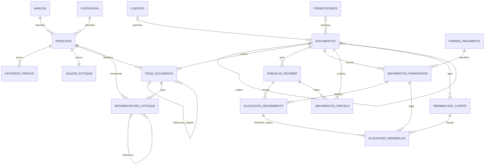

# Etapa 3 — Modelagem de dados e regras de negócio

**Estado: aprovado conceitualmente; implementação dividida em 3A–3D.** A entrega original
era somente documental. Na revisão seguinte, a 3A foi implementada nos serviços do processo
principal: migrações e cadastros, com DTOs independentes de plataforma. Estoque, operações
comerciais e financeiro permanecem planejados. Veja a
[entrega 3A e suas verificações](etapa-3A-migracoes-cadastros.md).
Não há UI ou novos canais IPC comerciais. O desenho abaixo descreve também partes futuras;
a seção 10 distingue o estado de cada entrega.

## 1. Base verificada antes da implementação 3A e fronteiras

Retrato do repositório em 31/10/2026, antes da 3A (não confundir com o estado atual):

- `electron/infrastructure/database/index.ts`: `better-sqlite3`, timeout de 5 segundos,
  `foreign_keys=ON`, `journal_mode=WAL`, `synchronous=FULL`; sem schema comercial.
- `electron/infrastructure/database/migrations/`: somente `.gitkeep`; sem executor.
- `electron/preload/index.ts`, `electron/ipc/index.ts` e `shared/contracts.ts`:
  API restrita ao diagnóstico, com validação do remetente e dos argumentos.
- `electron/main/index.ts`: `contextIsolation` e sandbox habilitados, Node desabilitado
  no renderer; protocolo local, CSP e navegação restritos.
- `electron/infrastructure/paths/index.ts`: produção fora da instalação, em
  `%LOCALAPPDATA%/MNR Software/MNR Perfumes`; desenvolvimento e smoke separados em
  `.local-data/development` e `.local-data/test`.
- `tests/database.test.cjs`: criação/reabertura, pragmas e ausência de tabelas comerciais.
  `tests/ipc.test.cjs` e `scripts/smoke.mjs`: segurança IPC e integração desktop.

Fluxo obrigatório futuro:

**Angular → API tipada do preload → IPC validado → serviços no processo principal → SQLite.**

SQL, filesystem, transações e regras financeiras pertencem ao processo principal.
Contratos compartilhados não dependem de Angular, Electron ou Node. Não haverá API
genérica para executar SQL, acessar arquivos ou invocar canais arbitrários.
Não são necessárias dependências novas para o desenho proposto.

A consulta em memória citada no planejamento anterior encontrou SQLite 3.53.4 em Node.
Isso é evidência anterior, não uma verificação nova nem garantia sobre o Electron.
Antes de implementar, consultar `sqlite_version()` nos dois runtimes e verificar
`STRICT`, FKs, transações imediatas e backup também no Electron empacotado.

## 2. Decisões e limites do negócio

| Tema                            | Decisão estabelecida                                              |
| ------------------------------- | ----------------------------------------------------------------- |
| Produtos                        | Cada apresentação é um produto; unidades inteiras                 |
| Estoque                         | Sem lotes, validade ou fracionamento em ml                        |
| Compras                         | Pagamento integral na confirmação, inclusive por múltiplas formas |
| Fornecedores                    | Sem contas a pagar, parcelas ou crédito futuro                    |
| Vendas                          | À vista ou a prazo; baixa de estoque na confirmação               |
| Contas a receber                | Cliente identificado, parcelas e vencimentos                      |
| Recebimentos                    | Parciais, antecipados e por múltiplas formas                      |
| Encargos                        | Sem juros, multas ou taxas                                        |
| Aquisição                       | Frete e despesas diretas integram custo                           |
| Devoluções                      | Integrais ou parciais; abater parcelas antes de gerar reembolso   |
| Produto sem condição de revenda | Retorno e perda vinculados, na mesma transação                    |
| Cancelamento de compra          | Bloqueado se houver movimentação posterior de qualquer produto    |
| Devolução ao fornecedor         | Reembolso imediato da mercadoria líquida, sem frete/despesas      |
| Venda abaixo do custo           | Permitida com justificativa por item                              |

Premissas propostas: BRL como única moeda; uma marca e uma categoria principal por
produto; sem reserva, produção de decants, cálculo fiscal ou comissões. Sem adiantamento
de cliente antes da venda e sem mudança de parcelamento após confirmar nesta versão.
Troca será devolução e nova venda. Relatórios e exportações consultarão o modelo sem
tabelas próprias inicialmente; exportações extensas usarão leitura consistente.
Reembolso pendente a cliente é obrigação de devolução, sem módulo de contas a pagar comerciais.
Nenhuma UI comercial será criada sem autorização específica.

## 3. Convenções e integridade

- Tabelas `STRICT`, usando apenas `INTEGER` e `TEXT`. Isso acrescenta validação de tipos,
  mas não substitui validação de entrada nem das relações entre registros.
  [SQLite STRICT](https://www.sqlite.org/stricttables.html).
- `id INTEGER PRIMARY KEY AUTOINCREMENT`, salvo chave explicitamente diferente.
  IDs expostos em DTOs também respeitarão o intervalo de inteiros seguros de JavaScript.
- Obrigatório implica `NOT NULL`; `?` indica opcional, normalizado para `NULL` se vazio.
- Dinheiro em centavos inteiros de BRL, sem `REAL` ou `parseFloat` financeiro.
- Quantidades inteiras; volume cadastral em microlitros, sem fracionamento de estoque.
- Instantes em UTC ISO 8601 padronizado; datas comerciais e vencimentos em `YYYY-MM-DD`,
  validadas como datas reais. Comparação de atraso usa a data local, com relógio injetável.
- Cadastros têm `ativo INTEGER CHECK(ativo IN (0,1))`, `criado_em` e `atualizado_em`.
- Toda FK usa `ON DELETE RESTRICT` e `ON UPDATE RESTRICT`, sem exclusão comercial em cascata.
  Manter FKs ligadas em cada conexão e indexar referências consultadas.
  [SQLite FKs](https://www.sqlite.org/foreignkeys.html).
- Campos monetários não negativos, salvo deltas e resultados explicitamente assinados.
  Limite absoluto monetário: 9.000.000.000.000 centavos, inclusive em saldos e totais.
  Quantidade e magnitude dos deltas limitadas a 1.000.000.000 unidades.
- Cálculos intermediários em `BigInt`; validar limites e inteiro seguro antes de converter
  para `number`. Não transportar `BigInt` diretamente por JSON/IPC.
- Descontos percentuais de entrada em pontos-base inteiros; persistir os centavos finais.
- Texto livre até 4.000 caracteres. Nome de marca/categoria/forma até 120; nome de
  produto/cliente/fornecedor até 200; SKU até 64. Remover espaços externos, rejeitar vazios.
- Chaves de busca/unicidade normalizadas por função determinística no processo principal,
  sem depender de `NOCASE` para acentos. Proposta: Unicode NFD, remover marcas diacríticas,
  caixa uniforme e espaços internos colapsados; preservar o texto de exibição.
  SKU usa normalização consistente de caixa e espaços externos, sem remover pontuação.
- Datas comerciais retroativas são permitidas, sem reordenar custeio. A ordem efetiva
  é a confirmação registrada, com IDs para desempate; não usar data comercial como ordem.
  Operações concluídas não terão data efetiva futura; vencimentos podem ser futuros.
- Documentos confirmados, itens e lançamentos históricos não são editáveis nem apagáveis.
  Exceção controlada: transição de estado para `ESTORNADO`, junto do documento de estorno,
  sem alterar conteúdo comercial original e com auditoria. Não haverá estorno sem origem.

### Responsabilidades

| Camada   | Garantias                                                                                 |
| -------- | ----------------------------------------------------------------------------------------- |
| IPC      | Remetente, frame, URL/canal, estrutura, tipos, limites e rejeição de campos inesperados   |
| Serviços | Compatibilidade entre entidades, regras, cálculos e transações                            |
| SQLite   | `NOT NULL`, `CHECK`, `UNIQUE`, FKs, proteção do histórico e invariantes críticas de saldo |

Restrições entre linhas não cabem em um simples `CHECK`: exigirão serviços transacionais
e triggers nas invariantes críticas. As proteções devem permitir a edição/descarte de
rascunhos, mas rejeitar alteração/exclusão de itens confirmados e históricos.

## 4. Modelo relacional

O diagrama representa documentos válidos; rascunhos podem estar vazios. Todas as relações
de origem são FKs reais, sem referência polimórfica em JSON.

### 4.1 Cadastros

Todas as colunas abaixo seguem as convenções de tipo e obrigatoriedade da seção 3.

| Tabela                                     | Colunas específicas, além de ID, ativo e datas                                                                                                                                                                                                                |
| ------------------------------------------ | ------------------------------------------------------------------------------------------------------------------------------------------------------------------------------------------------------------------------------------------------------------- |
| `marcas`, `categorias`, `formas_pagamento` | `nome TEXT`, `nome_chave TEXT UNIQUE`                                                                                                                                                                                                                         |
| `produtos`                                 | `sku TEXT UNIQUE`, `codigo_barras TEXT? UNIQUE`, `nome TEXT`, `marca_id INTEGER FK`, `categoria_id INTEGER FK`, `volume_microlitros INTEGER > 0`, `concentracao TEXT?`, `descricao TEXT?`, `preco_venda_centavos INTEGER >= 0`, `estoque_minimo INTEGER >= 0` |
| `clientes`, `fornecedores`                 | `nome TEXT`, `nome_chave TEXT` para busca, `tipo_pessoa TEXT?`, `documento TEXT?`, `telefone TEXT?`, `email TEXT?`, `endereco TEXT?`, `observacoes TEXT?`                                                                                                     |

`historico_precos`: `id`, `produto_id INTEGER FK`, `preco_anterior_centavos INTEGER? >= 0`,
`preco_novo_centavos INTEGER >= 0`, `motivo TEXT`, `registrado_em TEXT`, `operacao_id TEXT FK`.
É histórico de inserção somente, sem `ativo` ou datas de atualização.

SKU é obrigatório e não reutilizável após inativação; código de barras vazio vira `NULL`.
Documento pessoal/empresarial é opcional: informado, exige tipo compatível, normalização
e validação; proposta de tipos `PF`/CPF e `PJ`/CNPJ, usando as regras oficiais vigentes na
implementação, sem assumir apenas dígitos para todos os documentos futuros.
Unicidade parcial de documento preenchido em cada cadastro; nomes de pessoas não são únicos.
Marca e categoria devem existir e estar ativas para novas associações; inativar não apaga vínculos.
Produtos inativos não entram em novas compras/vendas, mas podem participar de correções da origem.
Forma inativa não aceita novo pagamento, mas permanece referenciável em estornos históricos.
Preço cadastral é sugestão; não muda vendas anteriores. Não existe custo atual manual no produto.

### 4.2 Documentos

| Coluna de `documentos`                        | Tipo e regra                                                              |
| --------------------------------------------- | ------------------------------------------------------------------------- |
| `id`, `numero`                                | ID padrão; `numero TEXT UNIQUE`, gerado pelo sistema                      |
| `tipo`                                        | `TEXT`: `COMPRA`, `VENDA`, `DEV_COMPRA`, `DEV_VENDA`, `AJUSTE`, `ESTORNO` |
| `estado`                                      | `TEXT`: `RASCUNHO`, `CONFIRMADO`, `ESTORNADO`                             |
| `documento_origem_id`                         | `INTEGER? FK documentos`; obrigatório em devolução/estorno                |
| `documento_corrigido_id`                      | `INTEGER? FK documentos`; novo documento que substitui registro incorreto |
| `cliente_id`, `fornecedor_id`                 | `INTEGER? FK`; contraparte compatível com a operação                      |
| `contraparte_nome`, `contraparte_documento`   | `TEXT?`; cópias históricas                                                |
| `modalidade_venda`                            | `TEXT?`: `A_VISTA` ou `A_PRAZO`                                           |
| `data_comercial`                              | `TEXT`, data válida                                                       |
| `subtotal_centavos`                           | `INTEGER >= 0`, soma dos brutos                                           |
| `desconto_itens_centavos`                     | `INTEGER >= 0`, soma dos descontos individuais                            |
| `desconto_global_centavos`                    | `INTEGER >= 0`, adicional do documento                                    |
| `frete_centavos`, `despesas_diretas_centavos` | `INTEGER >= 0`, compras                                                   |
| `total_centavos`                              | `INTEGER >= 0`, valor comercial final                                     |
| `motivo`, `observacoes`                       | `TEXT?`; motivo obrigatório em correções                                  |
| `criado_em`, `confirmado_em`                  | `TEXT`, `TEXT?`                                                           |
| `operacao_confirmacao_id`                     | `TEXT? UNIQUE FK operacoes`                                               |

Compra exige fornecedor; venda a prazo exige cliente; venda à vista pode ser avulsa.
Derivações herdam a contraparte da origem. Ajustes não possuem contraparte comercial.
Campos incompatíveis ficam em `NULL` ou zero. Origens confirmadas, tipo correto, sem
autorreferência/ciclos; documento corrigido só liga a uma correção rastreável válida.
Número não será reutilizado; sua apresentação não é requisito fiscal.

### 4.3 Itens

| Coluna de `itens_documento`                                  | Tipo e regra                                                          |
| ------------------------------------------------------------ | --------------------------------------------------------------------- |
| `id`, `documento_id`                                         | ID padrão; `INTEGER FK documentos`                                    |
| `sequencia`                                                  | `INTEGER > 0`; `UNIQUE(documento_id, sequencia)`                      |
| `produto_id`, `item_origem_id`                               | `INTEGER FK produtos`; `INTEGER? FK itens_documento`                  |
| `sku_historico`, `descricao_historica`                       | `TEXT`, cópias preservadas                                            |
| `quantidade`                                                 | `INTEGER > 0`, unidades                                               |
| `valor_unitario_centavos`, `valor_bruto_centavos`            | `INTEGER >= 0`; bruto = quantidade × unitário                         |
| `desconto_item_centavos`, `desconto_global_rateado_centavos` | `INTEGER >= 0`, limitados ao bruto disponível                         |
| `frete_rateado_centavos`, `despesas_rateadas_centavos`       | `INTEGER >= 0`, aquisição                                             |
| `valor_liquido_centavos`                                     | `INTEGER >= 0`, mercadoria após descontos                             |
| `valor_custo_estoque_centavos`                               | `INTEGER >= 0`, total efetivamente movimentado                        |
| `resultado_ajuste_centavos`                                  | `INTEGER` assinado, avaliação em devolução de compra; zero nos demais |
| `sentido_ajuste`                                             | `TEXT?`: `ENTRADA`/`SAIDA`, apenas ajuste                             |
| `destino_devolucao`                                          | `TEXT?`: `REVENDA`/`PERDA`, devolução de venda                        |
| `motivo`                                                     | `TEXT?`; obrigatório em ajuste, perda ou venda abaixo do custo        |

Uma linha por produto em compra/venda; uma por item original em cada devolução/estorno.
Item original deve pertencer ao documento de origem e ter o mesmo produto.
Quantidade devolvida acumulada efetiva não supera a original. Só um estorno efetivo
por documento; não acumular estorno integral com devoluções anteriores.
Confirmação exige item; rascunho pode ser editado/descartado e não gera efeitos.

Para compras/vendas: líquido do item = bruto − desconto individual − desconto global
rateado. Total = soma dos líquidos + frete + despesas (estes últimos apenas em compras).
Somas dos rateios coincidem exatamente com cabeçalho. Ajustes não têm valor comercial:
campos comerciais zerados, custo no campo próprio. Em devoluções, os valores históricos
proporcionais são a autoridade; `quantidade × valor_unitario` pode não representar os
centavos do líquido original, que inclui rateios. Preservar as componentes proporcionais
e conferir sua soma, sem reaplicar descontos atuais.

### 4.4 Estoque

| Tabela                  | Colunas                                                                                                                                                                                                                                                                                                                                         |
| ----------------------- | ----------------------------------------------------------------------------------------------------------------------------------------------------------------------------------------------------------------------------------------------------------------------------------------------------------------------------------------------- |
| `saldos_estoque`        | `produto_id INTEGER PRIMARY KEY FK`, `quantidade INTEGER >= 0`, `valor_total_centavos INTEGER >= 0`, `versao INTEGER >= 0`                                                                                                                                                                                                                      |
| `movimentacoes_estoque` | `id`, `produto_id INTEGER FK`, `item_documento_id INTEGER FK`, `natureza TEXT`, `quantidade_delta INTEGER`, `valor_delta_centavos INTEGER`, `quantidade_apos INTEGER >= 0`, `valor_apos_centavos INTEGER >= 0`, `movimentacao_origem_id INTEGER? FK`, `estorna_movimentacao_id INTEGER? UNIQUE FK`, `registrado_em TEXT`, `operacao_id TEXT FK` |

Naturezas propostas: `COMPRA`, `VENDA`, `DEV_COMPRA`, `DEV_VENDA`, `AJUSTE_ENTRADA`,
`AJUSTE_SAIDA`, `PERDA`, `ESTORNO`. `quantidade_delta != 0`; entrada positiva com valor
não negativo, saída negativa com valor não positivo; valor zero justificado quando aplicável.
Saldo sem quantidade exige valor zero. Criar saldo zero junto do produto.

Movimentos são imutáveis. Proposta de mecanismo único: trigger de inserção valida o
saldo anterior, aplica deltas, preenche/confere saldos posteriores e incrementa a versão;
o serviço não atualiza o saldo por outro caminho. A implementação deverá escolher uma
sequência SQL compatível com triggers SQLite (sem presumir atribuição a `NEW`).
Proibir alterações diretas normais ao saldo e testar as proteções com SQL adversarial.
Produto, item, origem e sentido precisam coincidir. Reconstrução usa deltas persistidos,
sem recalcular custos pelo algoritmo atual. Entrada de devolução com perda gera dois
movimentos no mesmo item; a perda referencia a entrada correspondente.

### 4.5 Contas a receber e dinheiro efetivo

| Tabela                   | Colunas                                                                                                                                                                                                                                                                                             |
| ------------------------ | --------------------------------------------------------------------------------------------------------------------------------------------------------------------------------------------------------------------------------------------------------------------------------------------------- |
| `parcelas_receber`       | `id`, `venda_id INTEGER FK documentos`, `numero INTEGER > 0`, `valor_original_centavos INTEGER > 0`, `vencimento TEXT`, `criado_em TEXT`; `UNIQUE(venda_id, numero)`                                                                                                                                |
| `movimentos_financeiros` | `id`, `documento_id INTEGER FK`, `natureza TEXT`, `sentido TEXT`, `valor_centavos INTEGER > 0`, `forma_pagamento_id INTEGER FK`, `forma_pagamento_historica TEXT`, `data_efetiva TEXT`, `registrado_em TEXT`, `estorna_movimento_id INTEGER? UNIQUE FK`, `observacoes TEXT?`, `operacao_id TEXT FK` |
| `alocacoes_recebimento`  | `id`, `movimento_financeiro_id INTEGER FK`, `parcela_id INTEGER FK`, `valor_centavos INTEGER > 0`, `natureza TEXT` (`APLICACAO`/`ESTORNO`), `estorna_alocacao_id INTEGER? UNIQUE FK`                                                                                                                |
| `abatimentos_parcela`    | `id`, `documento_correcao_id INTEGER FK documentos`, `parcela_id INTEGER FK`, `valor_centavos INTEGER > 0`, `natureza TEXT` (`ABATIMENTO`/`ESTORNO`), `estorna_abatimento_id INTEGER? UNIQUE FK`, `registrado_em TEXT`                                                                              |
| `reembolsos_cliente`     | `id`, `documento_correcao_id INTEGER UNIQUE FK`, `valor_centavos INTEGER > 0`, `registrado_em TEXT`                                                                                                                                                                                                 |
| `alocacoes_reembolso`    | `id`, `reembolso_id INTEGER FK`, `movimento_financeiro_id INTEGER FK`, `alocacao_recebimento_origem_id INTEGER FK`, `valor_centavos INTEGER > 0`, `natureza TEXT` (`PAGAMENTO`/`ESTORNO`), `estorna_alocacao_id INTEGER? UNIQUE FK`                                                                 |

Cliente é obtido da venda, sem duplicação na parcela. Naturezas financeiras:
`RECEBIMENTO_CLIENTE` (entrada), `PAGAMENTO_COMPRA` (saída), `REEMBOLSO_FORNECEDOR`
(entrada), `REEMBOLSO_CLIENTE` (saída), `ESTORNO_FINANCEIRO` (sentido oposto à origem).
Lançamentos registram dinheiro efetivo; vencimentos futuros não são caixa.
Estorno corrige o lançamento incorreto e é distinguido de uma transferência/reembolso real.

Cada recebimento pertence a uma venda; alocações somente em parcelas dessa venda.
Soma das alocações = valor do movimento. Cada reembolso referencia recebimentos da mesma
venda, não estornados e com valor ainda disponível. Soma de pagamentos não pode exceder
obrigação nem recebimentos de origem. Estorno é integral, exatamente oposto, uma única vez,
e suas alocações correspondem às originais, sem estorno de estorno em cadeia nesta versão.
Nova correção exige novo lançamento válido. Todas essas tabelas são de inserção somente.

### 4.6 Técnicas

| Tabela              | Colunas e finalidade                                                                                                                                                                                                                                             |
| ------------------- | ---------------------------------------------------------------------------------------------------------------------------------------------------------------------------------------------------------------------------------------------------------------- |
| `operacoes`         | `id TEXT PRIMARY KEY` (idempotência), `tipo TEXT`, `hash_entrada TEXT`, `resultado_json TEXT`, `registrado_em TEXT`                                                                                                                                              |
| `eventos_auditoria` | `id`, `operacao_id TEXT FK`, `documento_id INTEGER? FK`, `produto_id INTEGER? FK`, `cliente_id INTEGER? FK`, `fornecedor_id INTEGER? FK`, `evento TEXT`, `motivo TEXT?`, `antes_json TEXT?`, `depois_json TEXT?`, `registrado_em TEXT`, `versao_aplicativo TEXT` |
| `schema_migrations` | `versao INTEGER PRIMARY KEY`, `nome TEXT UNIQUE`, `checksum TEXT`, `aplicada_em TEXT`, `versao_aplicativo TEXT`                                                                                                                                                  |
| `metadados_banco`   | `id INTEGER PRIMARY KEY CHECK(id=1)`, `identificador TEXT UNIQUE`, `criado_em TEXT`, `moeda TEXT CHECK(moeda='BRL')`, `metodo_custeio TEXT`, `versao_regra_custeio INTEGER`                                                                                      |

JSON somente para auditoria e resposta idempotente, nunca como substituto das relações.
Auditoria de inserção somente; registrar alterações cadastrais e comerciais com operação.
Hash usa comando normalizado e serialização canônica, incluindo tipo/versão do comando.
Mesma chave e conteúdo devolvem resultado anterior; conteúdo diferente é erro.
Registrar a operação e todos os efeitos na mesma transação. Para satisfazer FKs durante
gravações, inserir a operação com resultado provisório interno e finalizá-lo antes do commit;
estado provisório nunca será confirmado nem exposto. Depois do commit, operação imutável.

### 4.7 Índices planejados

Além de PKs/UNIQUE, sem duplicar os índices já criados por essas restrições:

| Área                  | Índices                                                                                                                                                  |
| --------------------- | -------------------------------------------------------------------------------------------------------------------------------------------------------- |
| Produtos              | `(ativo, nome)`, `marca_id`, `categoria_id`                                                                                                              |
| Clientes/fornecedores | `nome_chave`; documento único parcial se não nulo                                                                                                        |
| Documentos            | `(tipo, estado, data_comercial, id)`, `(cliente_id, data_comercial)`, `(fornecedor_id, data_comercial)`, `documento_origem_id`, `documento_corrigido_id` |
| Itens                 | `produto_id`, `item_origem_id`; sequência única já coberta                                                                                               |
| Estoque               | `(produto_id, id)`, `item_documento_id`, `movimentacao_origem_id`; estorno único já coberto                                                              |
| Preços                | `(produto_id, registrado_em, id)`, `operacao_id`                                                                                                         |
| Parcelas              | `(vencimento, venda_id)`; venda/número já cobertos                                                                                                       |
| Financeiro            | `(documento_id, data_efetiva, id)`, `(natureza, data_efetiva)`, `forma_pagamento_id`, `operacao_id`                                                      |
| Alocações/abatimentos | FKs de parcela, movimento, origem, reembolso e documento corretivo não cobertas por outro índice                                                         |
| Auditoria             | `(documento_id, id)`, `(produto_id, id)`, `cliente_id`, `fornecedor_id`, `operacao_id`                                                                   |

Consultar `EXPLAIN QUERY PLAN` para relatórios antes de acrescentar índices.

## 5. Custeio, rateios e resultado

### Escolha proposta

| Método                 | Avaliação                                                                                             |
| ---------------------- | ----------------------------------------------------------------------------------------------------- |
| Média ponderada móvel  | Recomendado: adequado a apresentações sem lotes, estrutura menor; exige arredondamento determinístico |
| FIFO                   | Rastreia camadas consumidas, mas exige camadas, vínculos e correções mais complexas                   |
| Último custo           | Serve para sugestão futura de preço, inadequado para resultado histórico                              |
| Custo manual por venda | Exige intervenção constante e favorece inconsistência                                                 |

Persistir quantidade `Q` e valor total `V`; custo médio é a razão exata `V/Q`, sem
armazenar média decimal arredondada. Entrada de `q` unidades ao custo `C` produz
`Q'=Q+q`, `V'=V+C`. Saída total custa exatamente `V`; saída parcial de `q` custa
`roundHalfUp(V*q/Q)`. Para inteiros não negativos: `floor((2*n+d)/(2*d))`, `d>0`.
Usar `BigInt`; resíduo fica no estoque para saídas seguintes.

Exemplo: 2 unidades a R$ 100 e 1 a R$ 130 → `Q=3`, `V=R$ 330`.
Venda de uma unidade custa R$ 110; compra posterior não altera esse custo histórico.
Exemplo residual: `Q=3`, `V=100` centavos; saídas unitárias custam 33, 34 e 33,
esgotando exatamente os 100 centavos.

### Aquisição e descontos

1. Bruto = quantidade × unitário; subtrair desconto individual.
2. Ratear desconto global proporcionalmente aos valores após descontos individuais.
3. Ratear frete e despesas pelos líquidos resultantes.
4. Em cada rateio, tomar partes inteiras e distribuir centavos restantes pelos maiores
   restos das frações exatas; desempate por sequência do item.
5. Conferir limites e somas; custo de aquisição = líquido + frete + despesas rateadas.

Desconto global não supera base disponível; base toda zero só admite desconto zero.
Se todos os líquidos forem zero, frete/despesas usam quantidade como base.
Entrada totalmente gratuita exige motivo de bonificação.
Exemplo de rateio: 1 centavo entre três bases iguais vai ao primeiro item na sequência.

### Devoluções sucessivas

Para qualquer componente histórico total `T`, quantidade original `N`, devolvida acumulada
anterior `a` e nova `q`: reversão = `roundHalfUp(T*(a+q)/N) - roundHalfUp(T*a/N)`.
Aplicar às componentes necessárias, respeitando a identidade do líquido e custo original;
não arredondar um valor unitário para multiplicá-lo a cada devolução. Ao atingir `N`,
reverte exatamente `T`. Se componentes arredondadas separadamente gerarem diferença no
líquido, tratar o líquido histórico como autoridade e atribuir resíduo ao desconto global
rateado, ou ao desconto individual disponível, sem componente negativa. Este rateio
conjunto deverá ter teste de conservação antes de virar código.

Identificações, preços, descontos, custo efetivo e componentes de aquisição são históricos.
Mudança cadastral, data retroativa ou algoritmo novo não reprocessa vendas passadas.
Versionar a regra de custeio no banco e registrar mudanças no histórico de migrações.

Receita líquida comercial = vendas após descontos − devoluções/cancelamentos.
CMV = custo histórico vendido − reversões. Lucro bruto = receita líquida − CMV;
margem bruta = lucro bruto / receita líquida, não aplicável se receita zero.
Preservar resultados negativos. Recebimentos não determinam lucro; perdas e diferenças
de avaliação aparecem separadamente.

## 6. Operações atômicas

Todas as gravações comerciais usarão transações imediatas, síncronas e curtas, sem
diálogo, exportação ou `await` dentro da transação. SQLite permite um escritor por vez;
`BEGIN IMMEDIATE` antecipa a disputa pela escrita.
[Transações SQLite](https://www.sqlite.org/lang_transaction.html).
Falha em qualquer etapa desfaz documento, saldos, financeiro, auditoria e idempotência.

### Compra

1. Verificar chave idempotente e rascunho.
2. Validar fornecedor/produtos, valores, descontos e rateios.
3. Gravar snapshots e custos; inserir entradas de estoque.
4. Registrar pagamentos, um movimento por forma, soma igual ao total.
5. Confirmar, auditar e finalizar resultado idempotente.

Compra com total zero não cria pagamento zero; exige justificativa de gratuidade.

### Venda

1. Verificar idempotência/rascunho, cliente quando a prazo, produtos e descontos.
2. Consultar saldos dentro da transação; validar disponibilidade de todos os produtos.
3. Calcular custo histórico e exigir motivo por item vendido abaixo do custo total.
4. Criar parcelas cuja soma corresponde ao total; eventual recebimento inicial e alocações.
5. Inserir saídas, confirmar, auditar e finalizar idempotência.

Venda a prazo baixa estoque mesmo sem recebimento. Venda à vista tem parcela técnica,
vencendo na data comercial e integralmente paga na confirmação. Venda de total zero não
gera parcela ou movimento financeiro; continua exigindo motivo se abaixo do custo.

### Recebimento

Uma parcela admite várias baixas; um recebimento admite várias parcelas da mesma venda.
Formas diferentes produzem movimentos separados. Sem indicação explícita, aplicar em
ordem de vencimento e número. Antecipação paga parcela já existente antes de vencer.
Rejeitar excedente, sem carteira de crédito. Soma das alocações deve coincidir com dinheiro recebido.

### Status e reconciliação

Para cada parcela, sejam `P` valor original, `A` abatimentos líquidos e `R` recebimentos
aplicados líquidos de estornos. Exigir `0 <= A <= P`; saldo = `max(P-A-R,0)`.
O abatimento pode alcançar a parte já paga: excesso = `max(R-(P-A),0)`, que fundamenta
o reembolso. Portanto, **não** impor `A+R <= P` nem aceitar saldo a receber negativo.
Reembolso pago não remove a alocação original e não reabre a parcela; sua liquidação
é controlada separadamente em `alocacoes_reembolso`.

Status calculado nesta ordem: saldo zero → `QUITADO`; positivo e vencimento anterior
à data local → `VENCIDO`; positivo sem atraso e com recebimento → `PARCIALMENTE_PAGO`;
demais → `PENDENTE`. Parcela vencida mantém indicador de pagamento parcial.
Quitação por abatimento não é dinheiro recebido.

Por venda: `V` comercial líquido após correções; `R` recebimentos líquidos de estornos;
`F` reembolsos pagos líquidos de estornos. Saldo a receber = `max(V-(R-F),0)`;
reembolso pendente = `max((R-F)-V,0)`. Reconciliar com soma dos saldos das parcelas e
obrigações de reembolso menos suas liquidações. As regras de abatimento eliminam saldo
aberto antes de criar obrigação de reembolso; não misturar recebimento com abatimento.

Relatórios expõem separadamente: valor original, descontos, devoluções/cancelamentos,
líquido comercial, recebimentos, seus estornos, reembolsos pagos, saldo a receber e
reembolsos pendentes. Não somar um estorno de documento duas vezes por seu estado e por
seu documento corretivo: relatórios usam os efeitos históricos assinados uma única vez.

## 7. Correções

Toda correção exige motivo, origem, datas comercial/efetiva e de registro, auditoria,
idempotência e transação. Documento confirmado não é reescrito para aparentar outro evento.

### Venda cancelada ou devolvida

Cancelamento integral gera estorno, repõe custo histórico, extingue valores exigíveis e
gera reembolso do recebido, sem marcar pagamento fictício. Preserva recebimentos originais.
Com devolução parcial anterior, corrigir só o restante por devolução; não cancelar integralmente.

Devolução parcial respeita quantidade restante e valores históricos acumulados.
Abater primeiro parcelas abertas das últimas para as primeiras (vencimento/número decrescentes);
se exceder o saldo aberto, aplicar abatimento à parte paga, na mesma ordem, e gerar
obrigação pelo excedente. Identificar as alocações de recebimento que suportam essa parte,
com ordem determinística por ID, limitando reuso entre reembolsos. Não gerar crédito futuro.

Exemplo: venda R$ 300, recebido R$ 100, saldo R$ 200; devolução de R$ 250 abate
R$ 200 abertos e R$ 50 da parte paga. Ficam R$ 50 comerciais, saldo zero e R$ 50 a
reembolsar. Após pagar R$ 50, a obrigação zera e a parcela continua sem saldo aberto.

Sem condição de revenda: retornar pelo custo histórico e registrar perda igual,
vinculada à entrada, na mesma transação. Reembolso independe da condição física.

### Compra cancelada ou devolvida

Cancelamento só sem devoluções anteriores e sem movimentação posterior em qualquer produto
da compra, mesmo que saldo atual seja suficiente. Desfazer exatamente entradas e valores;
contralançar pagamento como correção de registro inválido, sem afirmar nova transferência.
Devolução física real usa `DEV_COMPRA`.

Devolução ao fornecedor referencia item original, limita quantidade devolvível e estoque
disponível. Saída pelo custo médio vigente; reembolso imediato da mercadoria líquida
histórica proporcional, sem frete/despesas. Sem crédito com fornecedor.
`resultado_ajuste_centavos = reembolso - custo retirado`: positivo indica ganho de avaliação,
negativo indica perda. Não alterar custos vendidos. Origem é comercial, sem afirmar
identificação física de unidades, pois não há FIFO.

### Ajustes e estornos de lançamentos

Entrada inicial, sobra, perda, avaria e contagem exigem motivo. Entrada manual exige custo
total; zero exige justificativa. Saída usa média vigente. Inventário registra contagem e
gera diferença após conferir versão do saldo; contagem sem diferença não gera movimento zero,
mas pode registrar auditoria. Nunca alterar saldo diretamente.

Recebimento incorreto: estornar integralmente movimento e alocações, depois lançar o correto.
Reembolso incorreto: estorno vinculado reabre obrigação. Documento incorreto: estorno quando
permitido e novo documento ligado pelo campo de correção. Rascunho tem edição livre.
Reembolsos e recebimentos estornados mantêm forma histórica, mesmo se inativada.

Para estornar devolução/ajuste, exigir ausência de movimentos posteriores nos produtos e
de efeitos financeiros dependentes. Dependências são desfeitas na ordem inversa.
Recebimento que fundamentou devolução, abatimento ou reembolso não pode ser estornado
isoladamente. Não reprocessar custos passados nem criar reembolso sem origem financeira.

## 8. Migrações, backup e restauração futuros

Migrações numeradas, ordenadas, imutáveis e empacotadas. Versão do schema independente
da versão do aplicativo; `schema_migrations` registra nome/checksum e `PRAGMA user_version`
é atualizado na mesma transação. Checksum alterado ou versão futura bloqueia operação.
Banco não vazio sem identidade reconhecida é preservado e bloqueado para diagnóstico.

Fluxo: identificar banco e versões → bloquear comandos comerciais → backup consistente
antes de alterar banco existente → aplicar conjunto pendente numa transação → registrar
histórico/checksums → `foreign_key_check` e `integrity_check` antes do commit → liberar só
após sucesso. Falha implica rollback, sem apagar/recriar banco. Reconstrução de tabelas
deve preservar índices/triggers e seguir o procedimento do
[SQLite ALTER TABLE](https://www.sqlite.org/lang_altertable.html).

Usar backup consistente, sem copiar apenas `.db` aberto em WAL.
[SQLite Backup API](https://www.sqlite.org/backup.html).
Manifesto: identificação do banco, versão do schema, aplicativo e data; incluir imagens
com caminhos relativos e política consistente quando existirem. Backup anterior à migração
é proteção interna independente de interface futura de backup.

Restauração: validar cópia em diretório temporário, recusar versão futura, migrar cópia
antiga compatível antes de ativar, fechar conexões e tratar WAL/SHM antes da troca.
Preservar cópia do estado anterior; nunca mesclar automaticamente bancos. A UI futura
deverá informar que restaurar substitui o estado e pode remover operações posteriores.

Banco ativo em disco local; WAL requer processos no mesmo computador e não serve como
solução para pasta de rede. [SQLite WAL](https://www.sqlite.org/wal.html).
Tratar explicitamente disco cheio, falta de energia e banco ocupado, preservando dados.
Auditoria é operacional, não inviolabilidade contra edição externa do arquivo.
Minimizar dados pessoais e planejar proteção nas cópias. Transição futura a FIFO requer
projeto/migração próprios, sem reescrever o resultado anterior.

## 9. Critérios de aceitação da implementação futura

| Grupo                 | Testes obrigatórios                                                                                                                                                                                                                     |
| --------------------- | --------------------------------------------------------------------------------------------------------------------------------------------------------------------------------------------------------------------------------------- |
| Schema/migrações      | Banco vazio, repetição, atualização desde cada versão suportada, rollback de falha intermediária, checksum alterado, versão futura, banco desconhecido preservado, integridade/FKs, SQL direto inválido e exclusão histórica rejeitados |
| Estoque/custos        | Conservação de centavos em rateios, bonificação/base zero, limites e overflow, saída total zera valor, histórico reconstrói saldo, alteração direta bloqueada, duas conexões disputando última unidade permitem só uma venda            |
| Compra/venda          | Pagamento integral, total zero, venda a prazo sem recebimento, falta de um produto desfaz tudo, abaixo do custo exige motivo, compra posterior preserva lucro, idempotência não duplica e rejeita conteúdo diferente                    |
| Parcelas/recebimentos | Soma igual à venda, várias datas/formas, antecipação, distribuição, excesso rejeitado, atraso na virada local com relógio controlado, estorno restaura saldo e distinção entre recebido/abatido                                         |
| Correções             | Devoluções sucessivas conservam quantidade/receita/custo, inclusive um centavo em várias unidades; perda vinculada, compra com movimento posterior bloqueada, devolução de compra e diferença de avaliação, últimas parcelas primeiro   |
| Reembolsos            | Excedente sem crédito, várias liquidações/formas, limites por obrigação e recebimento original, estorno reabre obrigação sem reabrir parcela, origem não reutilizada indevidamente                                                      |
| Dependências          | Cancelamento preserva histórico, estornos isolados dependentes bloqueados, desfazimento inverso, não duplicar correção no relatório                                                                                                     |
| Falhas/auditoria      | Injetar falha após cada gravação relevante e exigir rollback integral; auditoria de inserção somente, reconciliação por venda e estoque sem recalcular histórico                                                                        |
| Backup/plataforma     | Restauração preserva IDs, valores, versões e vínculos; backup em WAL com atividade, falha de migração preserva original; testar Node, Electron e pacote Windows 10/11                                                                   |

Após mudanças relevantes: `npm.cmd run typecheck`, `npm.cmd run lint`,
`npm.cmd run format:check`, `npm.cmd run build`, `npm.cmd test` e suítes novas pertinentes.
Na 3A, após aprovação conceitual, o teste de ausência de tabelas foi substituído por
verificação do schema versionado; a lista esperada ainda exclui estoque e financeiro.
Mudança de Electron/preload exige reiniciar `npm.cmd run dev`.
Não inferir validação de Windows 11 ou pacote distribuído a partir de teste Node.

## 10. Entregas 3A–3D

| Entrega | Escopo                                                                                     | Estado e critério                                                                                                                         |
| ------- | ------------------------------------------------------------------------------------------ | ----------------------------------------------------------------------------------------------------------------------------------------- |
| 3A      | Migrações, identidade/checksums, backup prévio, cadastros, auditoria e histórico de preços | Implementada e testada no processo principal; detalhes no relatório 3A                                                                    |
| 3B      | Estoque, movimentos, média ponderada inteira e reconciliação                               | Pendente; provar saldo não negativo, conservação de centavos e reconstrução histórica                                                     |
| 3C      | Compras/vendas, descontos, rateios, baixa, parcelamento e confirmações atômicas            | Pendente; testes de conservação exata em descontos/rateios/parcelas, rollback e prazo sem recebimento                                     |
| 3D      | Recebimentos, abatimentos, reembolsos, devoluções, cancelamentos e consultas financeiras   | Pendente; reconciliação, dependências, conservação de centavos e contratos distinguindo dinheiro, dívida reduzida e devolução de dinheiro |

Concluir e validar uma entrega antes de iniciar a seguinte. Serviços serão verificados
diretamente antes de expor contratos IPC, sempre mantendo a segurança atual. UI depende
de autorização específica. Preferir serviços síncronos, SQL explícito e transações locais;
não introduzir ORM, barramento de eventos, camadas genéricas ou concorrência distribuída.
Essa simplicidade não dispensa FKs, histórico, auditoria e testes de falha.

### Conservação dos centavos e contratos de consulta

Os critérios abaixo são requisitos futuros, não testes já aprovados na 3A:

- 3B: custo de saídas parciais mais estoque residual coincide com valor anterior;
  saída total zera quantidade e valor; usar também séries geradas deterministicamente.
- 3C: descontos/rateios conservam o total; soma das parcelas coincide com a venda,
  inclusive 1 centavo, bases zero, divisões inexatas, desempates e limites monetários.
- 3D: devoluções sucessivas conservam receita, descontos e custo históricos; soma dos
  reembolsos pagos e pendentes coincide com a obrigação, sem exceder recebimentos de origem.
- Casos gerados devem comparar totais e invariantes independentes, além dos exemplos;
  repetir o mesmo algoritmo no teste não prova conservação.

Consultas futuras de venda/parcela terão campos explícitos em centavos para
`valorOriginalCentavos`, `descontosCentavos`, `devolucoesCancelamentosCentavos`,
`valorComercialLiquidoCentavos`, `recebimentosEfetivosCentavos`,
`estornosRecebimentoCentavos`, `abatimentosDividaCentavos`,
`reembolsosPagosCentavos`, `estornosReembolsoCentavos`, `saldoReceberCentavos` e
`reembolsosPendentesCentavos`, com o recorte aplicável a cada entidade.
Não usar campo ambíguo `valorPago` que some recebimento e abatimento.
Líquidos e status serão derivados com as fórmulas da seção 6, preservando os componentes.
Os DTOs e testes dessas consultas serão entregues com 3D; não existem ainda no preload.

### Esclarecimentos incorporados nesta formalização

Para tornar o plano verificável, esta proposta explicita: `nome_chave` de pessoas necessário
ao índice de busca; exceção auditada para estado `ESTORNADO`; inicialização transacional
da operação idempotente antes das FKs; saldo não negativo com abatimento sobre parte paga;
reembolso sem reabertura da parcela; sinal da diferença de avaliação; totais zero;
contagem sem diferença; e conservação conjunta dos componentes em devoluções arredondadas.
Esses esclarecimentos integram o desenho aprovado conceitualmente. Apenas os relativos
à 3A estão implementados; fórmulas financeiras e custeio continuam para 3B–3D.
