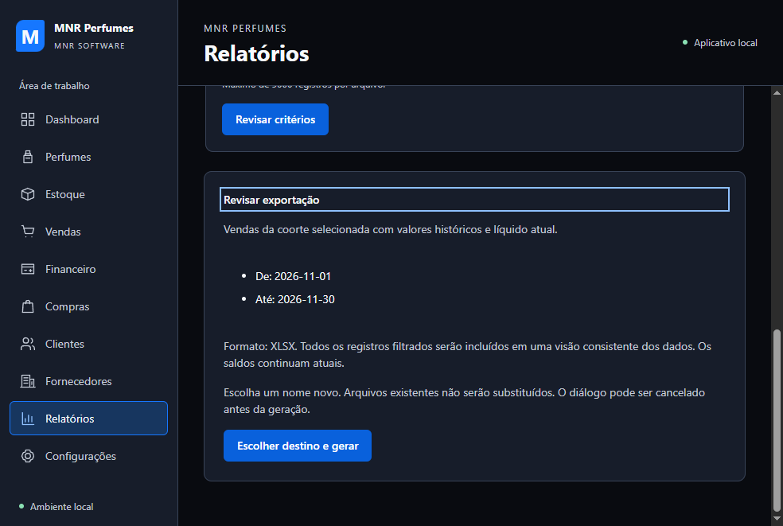
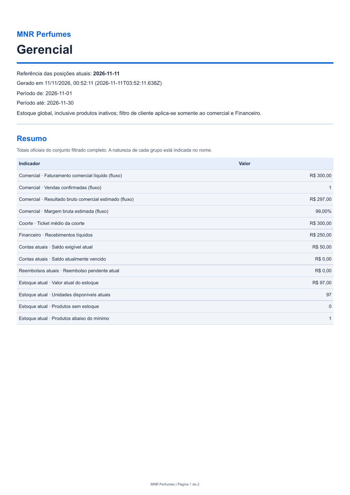

# 4F.3 — Relatórios e exportações Excel/PDF

## Recuperação após reinicialização — 12/11/2026

Diagnóstico concluído antes de modificar arquivos: cenário A. A implementação
e a bateria automatizada anterior já haviam terminado; não foi necessário
reimplementar funcionalidades. A causa da reinicialização não foi determinada.
O último commit é `407ead2` (4F.2); a 4F.3 permanece sem commit, preservada no
diretório de trabalho. Não houve reset, clean, reinstalação ou restauração de banco.

Foram conferidos AGENTS.md, README, relatórios integrais 4F.1/4F.2, escopo
autorizado disponível na sessão, status, diff dos 13 arquivos rastreados,
entradas do lockfile, arquivos novos, serviços, contratos, interface, testes,
relatório e seis capturas existentes. A lista da seção Arquivos abaixo identifica
o trabalho recuperado; todos esses arquivos foram mantidos. As alterações do
lockfile adicionam ExcelJS e sua árvore, sem remover pacotes nem trocar versões
de entradas anteriores. Não foram encontrados conflitos, arquivos truncados ou
imports inacabados no recorte inspecionado. Typecheck e build novos confirmaram
a integridade de compilação. Migrações, serviços comerciais/financeiros e
gerenciais, trust, main e Builder continuam sem diff em relação ao commit base.

O índice anterior `.cache/4f3-final-results.json` contém 23 resultados com saída
0, corroborados pelos logs completos e marcadores finais. Os últimos arquivos
de produção foram alterados até 11/11 às 00:47:49; exportações, pack, leitores
independentes e benchmark terminaram depois disso. O teste geral final terminou
às 01:00:46 com 169 aprovados e zero falhas. As regressões específicas financeiras
anteriores foram executadas antes dos últimos ajustes de apresentação; isso não
foi usado para dispensar sua repetição nesta recuperação.

Na inspeção de processos de 12/11 havia apenas Node do próprio Codex e do runtime
de automação; nenhum Electron, servidor Angular ou teste anterior ativo. Não
foram encontrados temporários `.mnr-export-*.tmp` sob os diretórios de teste.
Nenhum processo preexistente foi encerrado pela recuperação.

Todos os sete modelos, os dois formatos, coleta completa em snapshot, diálogo,
publicação segura, validações IPC, proteção de textos, interface e documentação
já estavam implementados e tinham evidências automatizadas. Não há funcionalidade
parcial ou ausente identificada nesse catálogo. Continua pendente a validação
manual do proprietário. Uma nova tentativa de inventariar janelas por Computer
Use retornou `native pipe is unavailable`/erro 2 em 12/11; não foi realizada nem
alegada interação nativa com Salvar/Escape. Os testes controlam apenas o retorno
do diálogo no processo de teste, como explicado abaixo.

Nova bateria concluída: `.cache/verify-4f3-recovery-20261112.ps1`, índice
`.cache/4f3-recovery-20261112-results.json` e logs correspondentes. Os resultados
anteriores foram preservados; os manifestos antigos receberam cópias
`.before-recovery-20261112` antes dos novos smokes. Cada comando é executado
novamente; nenhum resultado da execução de 10–11/11 foi reaproveitado no índice
novo. Os hashes dos fontes, testes, scripts, contratos e dependências foram
registrados em `.cache/4f3-recovery-20261112-source-hashes.json`.

### Resultados da nova execução

Em 12/11, entre 14:42 e 14:57 (horário local), foram concluídas 23 verificações,
todas com saída final 0. O fechamento documental e a formatação foram conferidos
novamente depois desta atualização. Comparação SHA-256 confirmou 283 arquivos
inalterados: fontes, contratos, testes, scripts, package/lockfile e Builder.
Nenhum código de produção ou teste foi modificado nesta recuperação; somente
este relatório e artefatos ignorados de diagnóstico foram criados/atualizados.
README e capturas versionáveis existentes permaneceram corretos e preservados.

| Verificação repetida                | Resultado de 12/11                                                                            |
| ----------------------------------- | --------------------------------------------------------------------------------------------- |
| `npm.cmd run typecheck`             | Passou                                                                                        |
| `npm.cmd run lint`                  | Passou                                                                                        |
| `npm.cmd run format:check`          | Passou; repetido após o relatório atualizado                                                  |
| `npm.cmd run build`                 | Passou                                                                                        |
| `npm.cmd test`                      | 169 aprovados, zero falhas; desktop/cadastros passaram                                        |
| `npm.cmd run test:ui`               | Passou integralmente                                                                          |
| `npm.cmd run test:financeiro`       | 45 testes e todos os cenários de UI passaram na repetição integral; ocorrência inicial abaixo |
| `npm.cmd run test:relatorios`       | 10 testes e cenário real/reabertura passaram                                                  |
| `npm.cmd run test:dashboard`        | 3 testes e cenário real/reabertura passaram                                                   |
| `npm.cmd run test:consolidacao`     | 2 testes e ciclo integrado/reabertura passaram                                                |
| `npm.cmd run test:exportacoes`      | 7 testes; 40 arquivos locais aprovados                                                        |
| `npm.cmd run pack`                  | Pacote Windows x64/ASAR gerado                                                                |
| `node scripts/verify-package.mjs`   | 46 bundles; worker/ExcelJS presentes, recursos de teste excluídos                             |
| Exportações `--development`         | 40 arquivos aprovados após fechar o aplicativo                                                |
| Exportações `--package`             | 40 arquivos aprovados após fechar o executável, offline emulado                               |
| Dashboard `--development`           | Passou, incluindo reabertura                                                                  |
| Dashboard `--package`               | Passou, incluindo reabertura/offline                                                          |
| Relatórios `--development`          | Passou, todos os métodos oficiais                                                             |
| Relatórios `--package`              | Passou, todos os métodos oficiais/offline                                                     |
| Smoke geral `--development`         | Passou                                                                                        |
| Smoke geral com executável Windows  | Passou                                                                                        |
| `npm.cmd run benchmark:exportacoes` | 50/200/500 vendas; 44 arquivos aprovados                                                      |
| `npm.cmd audit --omit=dev --json`   | Zero vulnerabilidades reportadas                                                              |

O total de 164 arquivos desta rodada inclui os 120 dos três ambientes e os 44
do benchmark. Os leitores verificaram estrutura, valores em centavos, texto,
cabeçalhos, datas, histórico e paginação, além da ausência de fórmulas/links
externos. O teste WAL repetido confirmou que linhas e total conservam R$ 300
enquanto um recebimento concorrente reduz a consulta nova para R$ 200. A coleta
de vendas retornou os 206 registros, ultrapassando a página de 200. No benchmark,
o XLSX contém todos os registros esperados; o PDF de 500 vendas tem 25 páginas e
Contas a receber tem 51. Nenhuma base foi alterada pelas consultas/exportações.

Manifestos novos: `.cache/4f3-{local,http,package}-exports.json`. O pacote usou
`.local-data/test/exports-4f3-Z4bUW0`; o benchmark,
`.local-data/test/export-benchmark-ORLT6A`. Os arquivos continuam válidos após
encerrar o processo. Foram inspecionados visualmente o novo PDF gerencial do
pacote, sua tela de revisão e a página 2 do PDF com 500 vendas: valores legíveis,
cabeçalhos repetidos e rodapé correto, sem cortes observados. Novas renderizações
ficam em `.cache/4f3-recovery-20261112-{gerencial,vendas-500-p2}.png`; capturas de
interface foram renovadas pelos smokes em `.cache/ui`.

Benchmark de recuperação (mesma metodologia/limites descritos abaixo):

| Vendas | Coleta máxima | XLSX máximo |  PDF máximo | RSS máximo |
| -----: | ------------: | ----------: | ----------: | ---------: |
|     50 |       9,12 ms |    55,47 ms |   456,98 ms |  143,7 MiB |
|    200 |      21,57 ms |    66,69 ms |   908,05 ms |  175,6 MiB |
|    500 |     105,96 ms |   200,91 ms | 1.751,39 ms |  218,2 MiB |

Os tempos de formato incluem geração/gravação. O resultado novo está em
`.cache/benchmark-exportacoes.json`; o anterior foi preservado com sufixo
`.before-recovery-20261112`. As métricas de 10–11/11 na seção abaixo são históricas.

### Ocorrência encontrada na regressão e pendências

A primeira execução de `test:financeiro` terminou com saída 1 no cenário de
interface de correções: `scripts/correcoes-scenario.cjs:107` esperava
`aria-invalid="true"` após uma quantidade inválida e recebeu null. Os 45 testes
de serviço haviam passado. O mesmo cenário já tinha passado no `test:ui` desta
rodada. O harness usa espera fixa de 60 ms após clicar; uma leitura antes da
atualização visual é uma hipótese, não causa comprovada.

O log e o índice dessa tentativa foram preservados em
`.cache/4f3-recovery-20261112-test-financeiro-first-failure.log` e
`.cache/4f3-recovery-20261112-first-failure-results.json`. O cenário isolado foi
repetido sem alterações e passou, incluindo reabertura, conforme
`.cache/4f3-recovery-20261112-correcoes-recheck.log`. Depois, todo o comando
`test:financeiro` foi executado novamente e passou. Não houve remoção de asserção,
mudança de regra ou correção especulativa no produto. A causa da ocorrência
intermitente continua não isolada e é uma limitação da evidência de automação.

Não houve requisito funcional a finalizar depois da retomada. Permanecem a
aprovação manual, a interação com o diálogo Windows real e as limitações externas
do checklist abaixo. Destinos sem hard links continuam recusados com mensagem;
offline emulado não equivale a teste físico sem rede. Nenhum avanço para 4F.4,
4G ou Etapa 5, commit ou push foi realizado.

## Estado da execução

Implementação e verificações automatizadas concluídas em 10–11/11/2026.
Aguardando validação manual do proprietário. Não avançar para 4F.4, 4G ou Etapa 5.
Não há commit ou push automático. As etapas até 4F.2 foram aprovadas e commitadas
pelo proprietário conforme a autorização. Base inicial limpa: `407ead2`.

Os arquivos foram preservados após uma interrupção externa da sessão, registrada
como `turn_aborted` durante uma solicitação de build/testes. A causa externa não
foi identificada. O estado foi inspecionado e a execução retomada, sem recomeçar,
descartar arquivos ou assumir aprovação de teste interrompido.
O smoke local inicial de 38 arquivos foi sucedido pelos testes finais de 40
arquivos em cada um dos três ambientes. Os resultados completos estão abaixo.

## Contexto reconstruído e arquitetura

Foram consultados AGENTS.md, README, relatórios 4E.2-A–E, integralmente os
relatórios 4F.1/4F.2, DTOs, SQL e serviço gerencial, serviço Angular, Dashboard,
Design System, rotas, mecanismos de fotografias/filesystem, Builder e segurança.
Git status/diff e commits recentes foram conferidos antes das alterações.

Angular controla formulário, revisão e mensagens. O renderer só envia um modelo
e filtros tipados; não recebe SQL, caminhos de destino ou o arquivo inteiro.
Dois canais literais no namespace `exportacoes`: `exportacoes:excel` e
`exportacoes:pdf`. O processo principal valida a solicitação, abre o diálogo
nativo, coleta e gera o documento, publica o arquivo e retorna somente nome,
formato, bytes, referência temporal e quantidade de registros de detalhe.

Não há geração automática ao abrir o aplicativo. A revisão mostra critérios e
formato antes de escolher o destino. Cancelar o diálogo retorna sucesso com
`cancelado: true`, sem coleta nem gravação. Durante a operação, campos e botão
ficam desabilitados; há guarda também no serviço Angular e no processo principal.
Navegação da tela é bloqueada durante a exportação. Não existe botão que prometa
cancelar uma geração já iniciada. Os arquivos são independentes do aplicativo.

## Catálogo fechado e filtros

| Modelo                    | Filtros oferecidos                                                 | Definição                                                                                                      |
| ------------------------- | ------------------------------------------------------------------ | -------------------------------------------------------------------------------------------------------------- |
| Gerencial                 | Período inclusivo e cliente ID opcional                            | 13 indicadores; comercial por fluxo, ticket de coorte, Financeiro/estoque atuais                               |
| Vendas                    | Período comercial, cliente/produto ID e DATA_DESC/VALOR_DESC       | Coorte com original histórico, líquido/custo histórico líquidos atuais e estado documental                     |
| Recebimentos e movimentos | Período efetivo, cliente/forma ID, natureza e DATA_DESC/VALOR_DESC | Recebimentos, pagamentos de reembolso e seus estornos; exclui fornecedores e alocações como dinheiro adicional |
| Contas a receber          | Cliente/venda ID, vencimento de/até e situação                     | Parcelas com recebimentos/abatimentos líquidos, saldo/status e totais oficiais atuais                          |
| Reembolsos                | Cliente/venda ID e situação                                        | Obrigação, venda/correção, original, pagamentos/estornos, pago líquido e pendente; anuladas distintas de pagas |
| Estoque                   | Produto ID, ativo, situação e ID/QUANTIDADE_DESC/VALOR_DESC        | SKU/nome cadastral atual, quantidade, valor persistido, mínimo e alertas; inclui inativos por padrão           |
| Desempenho                | Período e cliente ID                                               | Ranking completo de produtos por unidades líquidas DESC/ID e de clientes por líquido atual da coorte DESC/ID   |

Datas comerciais/efetivas são calendários ISO locais, sem conversão para UTC.
Intervalos têm até 366 dias inclusivos. Vencimentos são filtros da posição atual,
sem promessa de saldo histórico em uma data de corte. IDs em branco incluem
todas as referências aplicáveis; inativos continuam consultáveis.

O Dashboard oferece acesso aos relatórios com período/cliente explícitos nos
parâmetros de navegação. São aceitos somente calendários e IDs válidos e entram
no modelo Gerencial. Ao trocar de modelo, critérios incompatíveis são descartados
ou ignorados explicitamente. Estoque nunca recebe o filtro de cliente.

### Campos que não foram inventados

O DTO de Vendas da 4F.1 não traz valores individuais de devoluções/cancelamentos;
o arquivo informa essa ausência e preserva original e líquido atual oficiais.
Não calcula diferenças para chamar de correção. O DTO de estoque não traz custo
médio unitário; apresenta o valor total persistido e não o divide pela quantidade.
O modelo de Estoque é exclusivamente posição atual, sem movimento de período ou
reconstrução histórica. Os dois alertas são identificações a partir de quantidade
zero e quantidade menor que o mínimo formal, sem cálculo de custo.

Reembolsos usam a página e totais oficiais da 4F.1. Para pagamentos brutos e
estornos por obrigação, consultam também `createFinancialQueryService.obterReembolso`
da 4E.2-A na mesma conexão/transação. Esses valores já existem no contrato; não
foram somados ou reconstruídos no exportador. Líquido/pendente são comparados com
a página gerencial para detectar inconsistência.

## Consistência e snapshot

A coleta executa em worker Node do processo principal, com conexão SQLite
`readonly`, `fileMustExist`, `query_only=ON`, cache solicitado de 8 MiB e mmap
desabilitado. Não usa `openDatabase` para migrar ou reconciliar uma conexão de
exportação. Nenhuma tabela, migração, índice, auditoria, hash ou comando comercial
é escrito/alterado para gerar relatórios.

Uma transação DEFERRED externa fixa o snapshot WAL com leitura do schema antes
da primeira consulta. Os métodos oficiais da 4F.1 executam seus savepoints dentro
dela, na mesma conexão. Todas as páginas de 200 registros, totais, indicadores e
detalhes financeiros de um arquivo compartilham esse snapshot. O relógio de
referência é capturado uma vez e passado aos serviços. Nenhuma chamada IPC
sequencial independente é tratada como snapshot de exportação.

O coletor percorre `temMais` até o fim e verifica igualdade dos totais entre
páginas. Uma página intermediária incompleta é rejeitada. Totais vêm do conjunto
inteiro filtrado no backend; não são somas de linhas de uma página. A conexão e
a transação terminam antes de compressão XLSX, impressão PDF ou gravação.
O diálogo de destino ocorre antes da coleta, sem transação aberta enquanto o
usuário escolhe o local. Movimentações concorrentes podem confirmar em WAL sem
alterar o snapshot em curso.

## Excel

ExcelJS gera XLSX OOXML reais. Abas: Resumo, detalhe do modelo (Produtos e Clientes
no modelo Desempenho) e Metodologia. Gerencial tem Resumo e Metodologia.
Identificação MNR, título, referência, geração, critérios e notas estão nos
cabeçalhos. Estilos claros com azul institucional, larguras coerentes, linhas
alternadas, números alinhados, cabeçalho congelado, autofiltro e títulos de
impressão repetidos. Rodapé de impressão tem empresa e página/total.

Centavos e pontos-base permanecem inteiros até atribuir a célula numérica.
A conversão para reais/percentual exige inteiro seguro, até 15 dígitos
significativos e ida/volta equivalente também com precisão decimal de 15 dígitos.
O limite conservador é 999.999.999.999.999 unidades inteiras de origem; fora dele
o XLSX falha explicitamente com orientação de usar PDF/reduzir o conjunto.
Não há aproximação silenciosa. Moedas usam duas casas e percentuais duas casas;
datas normais são células de data. Datas anteriores a 01/03/1900 ficam como texto
ISO, evitando a ambiguidade de janeiro/fevereiro de 1900 na conversão da biblioteca
e os calendários anteriores ao sistema nativo do Excel. Os limites 0000/9999 e
a transição de 28/02 para 01/03/1900 foram conferidos por leitor independente.

Textos cadastrais são valores string/shared string, nunca objetos de fórmula ou
hiperlink. `=`, `+`, `-` e `@` permanecem texto. Não há fórmulas, macros, conexões
externas ou importação de planilhas pelo produto. Nomes de abas são fixos e
validados para limite de 31 caracteres/caracteres proibidos/duplicação.

## PDF

O HTML de impressão é construído exclusivamente no processo principal com todos
os valores escapados. É renderizado pelo Chromium/`webContents.printToPDF` do
Electron existente, sem dependência PDF adicional. Janela invisível sem preload,
JavaScript desabilitado, sandbox/contextIsolation/webSecurity ativos. Uma sessão
temporária exclusiva publica somente `mnr://report/index.html` em memória e
bloqueia todas as demais URLs, permissões e janelas. CSP própria restringe recursos;
não altera a CSP da janela do aplicativo. Não carrega fontes, imagens ou scripts
externos. A janela é destruída e o armazenamento temporário é limpo ao terminar.

A4 retrato para resumos e paisagem para tabelas largas. Fundo branco, Arial local,
azul institucional, critérios, notas, resumo e detalhes separados, cabeçalhos de
tabela repetidos, linhas sem quebra entre páginas e textos longos com quebra de
palavra. Rodapé inclui empresa e página/total em todas as páginas. Metodologia
fica em página própria. Valores são formatados por dígitos inteiros, sem somas
financeiras ou dependência de fórmulas.

## IPC e filesystem

Remetente, WebContents, frame principal e URL autorizada são conferidos antes do
handler. Aridade exata, objeto simples, modelo fechado, campos permitidos, datas,
IDs, enums e booleanos são validados. Filtros são validados novamente pelos
serviços oficiais. Não há nome arbitrário de função, SQL, formato livre, HTML ou
caminho de gravação fornecido pelo Angular. Erros internos são sanitizados, sem
stack, SQL, paths pessoais ou conteúdo documental nos logs de produção.

O diálogo nativo sugere nome descritivo e extensão coerente. O destino é
canonicalizado, com validação de extensão/nome Windows e bloqueio dos diretórios
de dados e instalação/código. Nunca substitui um arquivo já existente, mesmo se
outro processo criá-lo durante a operação. O arquivo é escrito em temporário
exclusivo no diretório escolhido, sincronizado e fechado, depois publicado por
hard link atômico com destino exclusivo. O temporário é removido em finally,
quando possível. Não há arquivo final parcial anunciado como sucesso.

Publicação depende de suporte a hard links, como NTFS. Destinos incompatíveis
recebem erro claro para escolher outra pasta. Arquivo existente, permissão,
destino indisponível, arquivo em uso e disco cheio têm mensagens próprias.
Cancelamento não grava. Encerramento abrupto durante escrita pode deixar um
temporário `.mnr-export-*.tmp`; não há limpeza recursiva de pastas do usuário nem
remoção automática de dados existentes.

## Dependências e empacotamento

Adicionado `exceljs` **4.4.0**, última versão estável informada pelo registro npm
na consulta desta execução. Necessário para XLSX formatado/typed sem implementar
OOXML manualmente. Apenas escrita de documentos criados a partir de DTOs próprios
é usada em produção; o produto não oferece leitura de arquivos XLSX externos.
Dependência `uuid` do ExcelJS fixada em **11.1.1** por override restrito, que corrige
o alerta transitivo registrado durante a instalação. ExcelJS usa `v4`, preservada
nessa versão CommonJS. Nenhuma atualização forçada da árvore anterior foi aplicada.

Referências primárias: [ExcelJS](https://github.com/exceljs/exceljs/releases),
[aviso/correção UUID](https://github.com/advisories/GHSA-w5hq-g745-h8pq) e
[printToPDF do Electron](https://www.electronjs.org/docs/latest/api/web-contents).
O lockfile registra a árvore e integridades. A auditoria completa inicial tinha
16 alertas moderados; após o override restaram 14 ligados à árvore de ferramentas
anterior (minimatch/Builder/ESLint). A auditoria final `npm audit --omit=dev`
retornou **zero vulnerabilidades reportadas** em produção. Isso não é uma alegação
de ausência absoluta de riscos; os alertas de ferramentas permanecem documentados.

Worker, geradores e biblioteca XLSX entram no ASAR como código/dependências de
produção. Scripts de controle de diálogo, CDP, fixtures, leitores independentes,
capturas e caches são exclusivos de teste e foram conferidos ausentes do pacote.
A inspeção encontrou 46 bundles de produção e confirmou worker e ExcelJS.
O ASAR final tem aproximadamente 56,3 MiB; não há medição comparável do ASAR
anterior para atribuir uma diferença exata somente à nova biblioteca.

## Limites e desempenho

Até 5.000 registros de detalhe por arquivo, 12 MiB de DTO serializado e 32 MiB
de arquivo. Coleta verifica duração de 10 segundos entre páginas/consultas;
worker tem timeout de 45 segundos, heap V8 de 192 MiB e geração jovem de 32 MiB.
PDF tem timeout adicional de 45 segundos. Cache SQLite limitado por conexão;
esses números não são um limite rígido de RSS, pois memória nativa/Chromium é
separada. Não há promessa de cancelamento imediato de uma instrução SQLite nativa
em execução. A interface permanece em seu próprio processo e recebe falha clara
se o worker exceder o limite. Geração maior é rejeitada, nunca truncada como sucesso.

Benchmark usa checkpoints de 50/200/500 vendas reais da 4F.1, exclusivamente sob
`.local-data/test`, abertos somente leitura. Não inclui criar fixtures nas
medições. Gera os sete modelos nos dois formatos pelo Electron e valida os
arquivos por leitores externos. Compara snapshot integral antes/depois das consultas.
Não mede partida a frio nem representa milhões de documentos. Resultados finais
em `.cache/benchmark-exportacoes.json`: 42 arquivos dos volumes e mais dois de
precisão/textos/datas, todos aprovados. O PDF de 500 vendas tem 25 páginas e o de
Contas a receber nesse volume tem 51 páginas, com todos os registros exportados.

Windows 10 build 19045 x64, Intel Core i7-7700 3,60 GHz, Electron 43.8.6
(Node embarcado 24.22.1); ferramentas CLI no Node 26.13.0. Uma execução por
modelo/formato; tabela mostra o maior tempo observado entre os sete modelos,
sem prometer mediana/p95 ou tempo em outro hardware.

| Vendas na base | Coleta máxima | XLSX: geração e gravação máximas | PDF: geração e gravação máximas | Maior RSS observado |
| -------------: | ------------: | -------------------------------: | ------------------------------: | ------------------: |
|             50 |      14,24 ms |                         71,92 ms |                       487,59 ms |           145,1 MiB |
|            200 |      15,48 ms |                         54,83 ms |                       632,44 ms |           176,1 MiB |
|            500 |      65,70 ms |                        116,21 ms |                     1.086,67 ms |           218,3 MiB |

Coleta medida uma vez por modelo, reutilizada nos dois formatos. RSS é do
processo Electron de benchmark após cada arquivo, incluindo runtime e alocações
nativas, sem somar processos Chromium e sem equivaler ao heap do worker.
Esse harness chama os mesmos coletor/geradores diretamente; não inclui IPC e
partida do aplicativo. Os smokes de UI/ASAR verificam separadamente o caminho
real por preload/IPC/worker. Não houve escrita nas bases de benchmark.

## Testes, problemas e próximos passos

Problemas já encontrados/corrigidos:

- Nome de parâmetro da consulta financeira (`reembolsoId`, não `id`).
- Bloqueio do próprio `data:` pela proteção de rede da impressão: substituído por
  URL local fixa em sessão exclusiva, sem dados pessoais na URL.
- Teste do registrador precisava incluir os dois canais, manter o mock de
  registro injetado e limpar canais entre origens. Não foram removidas asserções.
- Rodapé Excel ganhou marcador central OOXML para ser interpretado pelo leitor.
- Resumo Gerencial reduzido aos 13 indicadores solicitados, com rótulos de natureza.
- O teste de Tab partia de campo de data editável, que tem segmentos internos.
  Foi corrigido para testar entrada pelo seletor de formato e retorno por
  Shift+Tab, mantendo foco, Enter, Escape e valores. A falha original está em
  `.cache/4f3-keyboard-initial-failure.log`, sem remoção de asserções de negócio.
- Notas visíveis foram reescritas em linguagem de negócio; os testes afetados e
  o pacote foram repetidos. Calendários iniciais do Excel ficam em texto ISO
  para impedir deslocamento silencioso de data.

Testes específicos de serviços/IPC cobrem modelos fechados, validação, precisão,
texto especial, histórico, inativos, cenário financeiro 300/250/200/150, pagamentos
e estornos, anuladas, páginas completas, snapshot com recebimento concorrente,
ausência de escrita, cancelamento, duplicidade, falhas e salvamento exclusivo.
Leitores independentes conferem ZIP/OOXML com openpyxl, PDF com pypdf/pdfplumber,
títulos, critérios, cabeçalhos, linhas/valores, datas, rodapés, A4 e limites de
caracteres dentro da página. Poppler gera PNGs para inspeção visual.

`test:exportacoes` usa Python com pypdf/pdfplumber/openpyxl, pelo runtime local
disponível nesta máquina ou `MNR_TEST_PYTHON`. Essas dependências de validação não
são necessárias ao usuário final e não são incluídas no aplicativo.
Versões usadas na leitura independente: Python 3.12.14, pypdf 6.10.0,
pdfplumber 0.11.9 e openpyxl 3.1.5. `pdftoppm` do Poppler foi usado para renderizar
as capturas; a geração de produção usa exclusivamente o Electron existente.

Smokes controlam **somente no processo de teste** o retorno do diálogo nativo via
depuração do processo principal. Não inserem paths ou hooks no renderer de
produção. O próprio aplicativo coleta, gera e salva, inclusive no executável
empacotado. Arquivos são reabertos por leitores externos após encerrar o app.

A tentativa adicional de controlar o diálogo Windows real ficou indisponível:
Computer Use retornou `native pipe is unavailable`/erro 2 após reinicialização e
tentativa pela interface alternativa. Nenhum clique nativo foi realizado nem
alegado como validado. A interação real com Salvar/Escape fica no checklist manual;
os retornos cancelado/destino e o fluxo Angular são verificados automaticamente.

## Resultados finais e evidências

Índice `.cache/4f3-final-results.json`: 23 verificações, todas com código de saída 0. Logs `.cache/4f3-final-*.log`; pipeline `.cache/verify-4f3.ps1`. Tentativas
iniciais e o índice anterior à revisão textual foram preservados em `.cache`.
Esses artefatos são de teste e não entram no ASAR. Mensagens de erro injetadas
após commit nos cenários anteriores são esperadas e não foram tratadas como
aprovação sem asserções e encerramento com código 0.

| Verificação                                             | Resultado real                                                                                            |
| ------------------------------------------------------- | --------------------------------------------------------------------------------------------------------- |
| `npm.cmd run typecheck`                                 | Passou; repetido no fechamento                                                                            |
| `npm.cmd run lint`                                      | Passou; repetido no fechamento                                                                            |
| `npm.cmd run format:check`                              | Passou, incluindo relatório e README finais                                                               |
| `npm.cmd run build`                                     | Angular, Electron e preload passaram, também nos recortes e pack                                          |
| `npm.cmd test`                                          | 169 testes, todos aprovados; cadastros nas duas origens e smoke desktop passaram                          |
| `npm.cmd run test:ui`                                   | Todos os módulos e consolidação, nova rota de relatórios, teclado, foco, tamanhos/zoom e offline passaram |
| `npm.cmd run test:financeiro`                           | 45 testes e cenários reais passaram                                                                       |
| `npm.cmd run test:relatorios`                           | 10 testes e os 13 métodos oficiais passaram                                                               |
| `npm.cmd run test:dashboard`                            | 3 testes, cenário real e reabertura passaram                                                              |
| `npm.cmd run test:consolidacao`                         | 2 testes e ciclo integrado/reabertura passaram                                                            |
| `npm.cmd run test:exportacoes`                          | 7 testes e smoke local; 40 arquivos aprovados por leitores independentes após fechar o app                |
| `npm.cmd run pack`                                      | Pacote Windows x64 com ASAR produzido                                                                     |
| `node scripts/verify-package.mjs`                       | 46 bundles; worker/ExcelJS presentes; testes/scripts/caches excluídos                                     |
| `node scripts/exportacoes-smoke.mjs --development`      | Fluxo Angular/IPC/worker por HTTP; 40 arquivos aprovados e reabertura                                     |
| `node scripts/exportacoes-smoke.mjs --package`          | Executável com rede offline emulada; 40 arquivos aprovados e reabertura                                   |
| Dashboard, Relatórios e smoke geral com `--development` | Todos passaram em novos processos e bases isoladas                                                        |
| Dashboard, Relatórios e smoke geral empacotados         | Todos passaram com reabertura/offline emulado                                                             |
| `npm.cmd run benchmark:exportacoes`                     | 50/200/500 vendas, 42 arquivos mais dois de precisão; leitura independente aprovada                       |
| `npm.cmd audit --omit=dev --json`                       | Zero vulnerabilidades reportadas na árvore de produção                                                    |

As capturas abaixo foram renderizadas/inspecionadas a partir dos arquivos finais.
Os relatórios de Gerencial/Estoque e as telas são do executável empacotado; os
exemplos de múltiplas páginas e precisão são do ensaio Electron isolado.

Outras evidências: [formulário](evidencias-4F3/interface-filtros.png),
[estoque com nome longo/inativo](evidencias-4F3/estoque.png),
[página 2 de 25 em 500 vendas](evidencias-4F3/vendas-500-pagina-2.png) e
[precisão, caracteres e datas extremas](evidencias-4F3/precisao.png).

Capturas adicionais nos três tamanhos e três escalas ficam em
`.cache/ui/exportacoes-{local,http,package}-*.png`. O smoke específico usa viewport
e escala CDP equivalentes a 100/125/150%; a suíte geral usa a matriz existente de
janela/zoom Electron real. Documento e área principal sem overflow horizontal.
Migrações 0001–0005, serviços financeiros/comerciais, SQL gerencial, trust, main,
CSP de produção e Builder foram conferidos sem alterações. Nenhum banco real
foi usado como fixture, recriado ou apagado.

## Arquivos

- `shared/exportacoes.ts`, `shared/contracts.ts`: contratos, catálogo e limites.
- `electron/services/exportacoes/{validacao,documento,worker,geracao,xlsx,html,pdf,arquivos}.ts`:
  validação, snapshot oficial, worker, formatos e publicação segura.
- `electron/ipc/exportacoes.ts`, `electron/ipc/index.ts`, `electron/preload/index.ts`:
  dois canais protegidos e métodos literais.
- `src/app/core/{exportacoes.service,desktop.service,navigation}.ts`:
  estado/ponte tipada e rota.
- `src/app/features/relatorios/relatorios.{ts,html,scss}`: formulário e revisão.
- `src/app/features/dashboard/dashboard.html`: acesso com contexto explícito.
- `tests/exportacoes*.test.cjs`, `tests/cadastros-ipc.test.cjs`: testes e canais.
- `scripts/exportacoes-{cdp,smoke}.mjs`, `scripts/verify-exportacoes.py`:
  aplicação real, UI e leitores independentes.
- `scripts/benchmark-exportacoes{.mjs,-main.cjs}`: volumes e arquivos completos.
- `scripts/cadastros-desktop.cjs`, `scripts/verify-package.mjs`: limpeza de canais
  de teste e inspeção do worker/dependência no pacote.
- `package.json`, `package-lock.json`, README e este relatório.
- `docs/evidencias-4F3/*.png`: seis capturas finais da interface e dos PDFs.

## Checklist manual e limitações externas

- Abrir Relatórios; revisar filtros; salvar XLSX e PDF pelo diálogo Windows real.
- Cancelar por Escape; confirmar mensagem e ausência de arquivo.
- Escolher nome existente; confirmar que o original permanece intacto.
- Abrir os arquivos no Excel/LibreOffice/leitor PDF com o aplicativo fechado.
- Conferir venda, recebimentos, devolução, reembolso e estornos contra o Financeiro.
- Conferir estoque atual e notas de fluxo/coorte/posição.
- Navegar a partir do Dashboard e trocar modelos, sem filtros incompatíveis.
- Testar teclado, foco e zoom na máquina do proprietário.

Windows 11, leitor de tela, Excel instalado, máquina fisicamente desconectada,
instalador/atualização/desinstalação NSIS e assinatura digital não foram validados
nesta etapa. Offline do pacote é emulado. Não há NFe, DRE/lucro líquido,
exportação livre, nuvem, e-mail, 4F.4, 4G ou Etapa 5.
