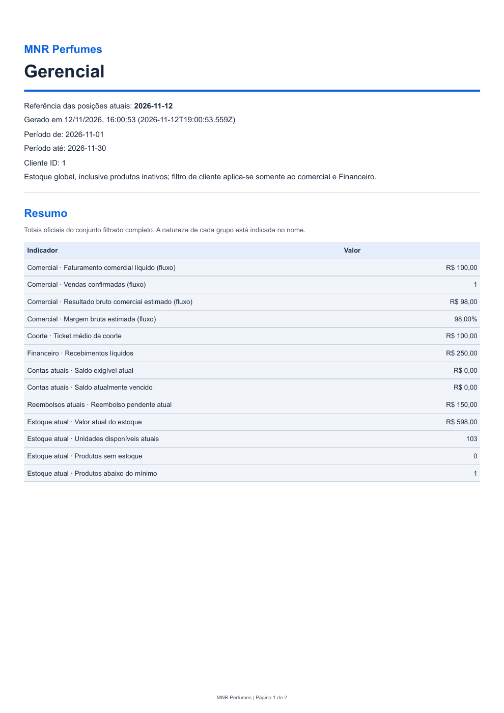

# 4F.4 — Consolidação integral do módulo gerencial

## Estado da execução

Consolidação técnica concluída em 12/11/2026, aguardando validação manual do
proprietário. As 37 verificações finais terminaram com saída 0; a tentativa
anterior de captura que falhou permanece registrada. Sem commit/push ou avanço
para 4G/Etapa 5. Não foi comprovado defeito nas regras ou interfaces de produção.

Fechamento adicional após a documentação aprovado: typecheck, lint, format:check
e npm test (171 aprovados, zero falhas), com build/cadastros/smoke desktop.
Logs `.cache/4f4-closing-{typecheck,lint,format,test}.log`. As 37 verificações
principais e esse fechamento estão concluídos; validação manual segue pendente.

## Diagnóstico inicial

Base limpa em `b949a1c` (4F.3), precedida por `407ead2` (4F.2) e `a06a719`
(4F.1). Aprovação manual e commits anteriores informados pelo proprietário.
Antes de editar foram consultados AGENTS, README, relatórios 4E.2-A–E e os três
relatórios 4F integrais, dicionário, contratos, serviços/SQL, componentes, IPC,
preload, isolamento, worker, geradores, publicação e Builder. Nenhum trabalho
não commitado foi encontrado. Não houve reset, limpeza ou troca de banco.

Lacunas identificadas: acompanhar o mesmo estado nas consultas, Dashboard e
sete modelos de arquivos ao longo do ciclo; comparar o prefixo de cinco itens
do Dashboard com rankings completos empatados; testar falhas reais na fronteira
de publicação e encerramento antes do hard link; reforçar a conferência de
linhas/ordem do PDF e precisão decimal dos leitores independentes.

Não foi comprovado defeito de produto nesta consolidação. Não foram alteradas
regras financeiras, migrações, índices, limites, contratos ou componentes.

## Integração, fontes e reprodução

`npm.cmd run test:consolidacao-gerencial` compila, executa nove testes de serviços,
IPC e publicação e chama o aplicativo real com `--consolidacao-gerencial`.
O mesmo flag funciona com `--development` e `--package`. O cenário amplia o smoke
4F.3 existente; não cria canais, rotas, preload ou hooks de produção. Angular
continua usando exclusivamente a API tipada. Fixtures escrevem somente pelos
serviços comerciais existentes, entre checkpoints, fora da fase de comparação.

Em cada checkpoint, o teste consulta os DTOs via preload/IPC, lê os 13 cartões,
rankings e tabelas alternativas dos gráficos no DOM e percorre o link real para
Relatórios. Confere o contexto de período/cliente, gera os sete modelos nos dois
formatos, compara os documentos com as consultas e depois reabre os arquivos
usando openpyxl, pypdf e pdfplumber, com o aplicativo fechado. As respostas do
Financeiro também são comparadas diretamente com a coorte/saldos da 4F.1 no ciclo
de referência. Os itens originais são comparados integralmente após cada passo.

Todos os bancos, perfis e arquivos novos ficam em `.local-data/test`. Cada fase
de leitura tem snapshot integral de tabelas antes/depois; o coletor no harness
executa com `query_only=ON`, além do worker readonly de produção. Não há escrita
concorrente nessa comparação entre módulos. As chamadas do Dashboard continuam
independentes; não se introduziu snapshot persistente entre interfaces e arquivos.

## Matriz de consistência

RG significa `obterResumoGerencial`; E significa `obterResumoEstoque.posicaoAtual`.
As regras oficiais permanecem no dicionário e serviço/SQL da 4F.1. Valores abaixo
foram conferidos após a devolução mista de R$ 200, com compra posterior que muda
a média atual. A bateria final repetiu a matriz nos três ambientes. Comparação
dos índices confirmou igualdade dos valores/textos nos onze checkpoints e treze
indicadores, além das verificações individuais de cada arquivo.
Valores monetários desta tabela estão em reais, mas as comparações usam centavos
inteiros. Percentuais têm origem em pontos-base, sem recomputar margem no teste.

| Informação               | Fonte oficial                                    |   4F.1 | Dashboard | XLSX Gerencial | PDF Gerencial | Semântica                   | Comparação local |
| ------------------------ | ------------------------------------------------ | -----: | --------: | -------------: | ------------: | --------------------------- | ---------------- |
| Vendas confirmadas       | RG.fluxoComercial.vendasConfirmadas              |      1 |         1 |              1 |             1 | Fluxo comercial             | Igual            |
| Faturamento líquido      | RG.fluxoComercial.faturamentoLiquidoCentavos     | 100,00 |    100,00 |         100,00 |        100,00 | Fluxo comercial             | Igual            |
| Ticket                   | RG.coorteVendas.ticketMedioCentavos              | 100,00 |    100,00 |         100,00 |        100,00 | Coorte atual                | Igual            |
| Recebimentos líquidos    | RG.fluxoFinanceiro.recebidoLiquidoCentavos       | 250,00 |    250,00 |         250,00 |        250,00 | Fluxo financeiro            | Igual            |
| Resultado bruto estimado | RG.fluxoComercial.resultadoBrutoEstimadoCentavos |  98,00 |     98,00 |          98,00 |         98,00 | Fluxo/custo histórico/perda | Igual            |
| Margem bruta estimada    | RG.fluxoComercial.margemBrutaPontosBase          | 98,00% |    98,00% |         98,00% |        98,00% | Fluxo, denominador positivo | Igual            |
| Saldo exigível           | RG.posicaoAtual.contas.exigivelCentavos          |   0,00 |      0,00 |           0,00 |          0,00 | Posição atual               | Igual            |
| Total vencido            | RG.posicaoAtual.contas.vencidoCentavos           |   0,00 |      0,00 |           0,00 |          0,00 | Posição atual               | Igual            |
| Reembolsos pendentes     | RG.posicaoAtual.reembolsos.pendenteCentavos      | 150,00 |    150,00 |         150,00 |        150,00 | Posição atual ativa         | Igual            |
| Valor do estoque         | E.valorCentavos                                  | 598,00 |    598,00 |         598,00 |        598,00 | Posição atual global        | Igual            |
| Quantidade disponível    | E.unidades                                       |    103 |       103 |            103 |           103 | Posição atual global        | Igual            |
| Produtos sem estoque     | E.semEstoque                                     |      0 |         0 |              0 |             0 | Posição atual global        | Igual            |
| Abaixo do mínimo         | E.abaixoMinimo                                   |      1 |         1 |              1 |             1 | Mínimo formal atual         | Igual            |

Nem todo campo da 4F.1 é exibido nas interfaces aprovadas. “Não exposto” abaixo
é uma fronteira de catálogo, não uma igualdade inventada ou um novo requisito
de interface. Onde não há correspondência, a auditoria confere o DTO e os efeitos
nos indicadores existentes, sem criar relatório ou cartão adicional.

| Informação / checkpoint               | Fonte oficial e valor 4F.1                                              | Dashboard                                       | XLSX                                         | PDF                         | Semântica / resultado                                 |
| ------------------------------------- | ----------------------------------------------------------------------- | ----------------------------------------------- | -------------------------------------------- | --------------------------- | ----------------------------------------------------- |
| Original da venda / devolução         | listarVendas.originalCentavos = 300,00                                  | Sem cartão individual                           | Vendas: 300,00                               | Vendas: 300,00              | Histórico preservado; igual                           |
| Comercial atual da venda / devolução  | listarVendas.comercialLiquidoAtualCentavos = 100,00                     | Ranking cliente: 100,00                         | Vendas/Desempenho: 100,00                    | Vendas/Desempenho: 100,00   | Coorte atual; igual                                   |
| Devoluções registradas / devolução    | RG.fluxoComercial.devolucoesRegistradasCentavos = 200,00                | Sem cartão individual                           | Não exposto individualmente                  | Não exposto individualmente | Fluxo; efeito no faturamento conferido                |
| Cancelamentos / cancelamento          | RG.fluxoComercial.cancelamentosCentavos = 300,00                        | Sem cartão individual                           | Estado ESTORNADO e líquido zero na venda     | Mesmo estado/líquido        | Fluxo próprio; estado e efeito conferidos             |
| Estorno da devolução                  | RG.fluxoComercial.estornosDevolucaoCentavos = 200,00                    | Sem cartão individual                           | Líquido restaurado a 300,00                  | Líquido restaurado a 300,00 | Fluxo próprio; restauração conferida                  |
| Custo histórico líquido / devolução   | RG.fluxoComercial.cmvHistoricoLiquidoCentavos = 1,00                    | Considerado no resultado                        | Vendas: 1,00                                 | Vendas: 1,00                | Custo persistido; igual                               |
| Perda imprópria / devolução           | RG.fluxoComercial.perdasImpropriosLiquidasCentavos = 1,00               | Considerada no resultado                        | Sem campo individual                         | Sem campo individual        | Resultado 98,00 conferido                             |
| Recebido bruto / devolução            | RG.fluxoFinanceiro.recebimentosBrutosCentavos = 250,00                  | Sem cartão bruto                                | Movimentos: 250,00                           | Movimentos: 250,00          | Data efetiva; igual                                   |
| Estornos de recebimento / devolução   | RG.fluxoFinanceiro.estornosRecebimentosCentavos = 0,00                  | Sem cartão individual                           | Movimentos: 0,00                             | Movimentos: 0,00            | Fluxo; igual; cenário não zero na regressão Dashboard |
| Vencido e a vencer / devolução        | RG.posicaoAtual.contas = 0,00 / 0,00                                    | Vencido 0,00; a vencer sem cartão               | Contas: 0,00 / 0,00                          | Contas: 0,00 / 0,00         | Posições atuais; igual                                |
| Parcelas vencidas / devolução         | RG.posicaoAtual.contas.parcelasVencidas = 0                             | Sem contador individual                         | Contas: 0                                    | Contas: 0                   | Contagem/status oficiais                              |
| Obrigação original / devolução        | listarReembolsos.originalCentavos = 150,00                              | Cartão pendente 150,00                          | Reembolsos: 150,00                           | Reembolsos: 150,00          | Obrigação ativa; igual                                |
| Pagamento / pagamento                 | RG.fluxoFinanceiro.pagamentosReembolsoCentavos = 100,00                 | Sem cartão pago                                 | Movimentos e Reembolsos: 100,00              | Mesmo valor                 | Fluxo e obrigação identificados; igual                |
| Estorno de pagamento                  | RG.fluxoFinanceiro.estornosReembolsoCentavos = 100,00                   | Sem cartão individual                           | Movimentos e Reembolsos: 100,00              | Mesmo valor                 | Histórico mantido; igual                              |
| Pago líquido / pagamento → estorno    | RG.fluxoFinanceiro.reembolsoPagoLiquidoCentavos = 100,00 → 0,00         | Sem cartão pago                                 | Movimentos/Reembolsos: 100,00 → 0,00         | Mesmo valor                 | Igual                                                 |
| Obrigação anulada / estorno devolução | listarReembolsos.ativa = false; pendente 0,00                           | Pendente 0,00                                   | ANULADA, original 150,00, pendente 0,00      | Mesmos campos               | Anulada distinta de paga; igual                       |
| Produto inativo / devolução           | listarSaldos.ativo = false; 103 unidades / 598,00                       | Alertas usam nome atual; saldos incluem inativo | Estoque: Inativo, 103 / 598,00               | Mesmos campos               | Cadastro atual, sem substituir histórico              |
| Compra / devolução                    | obterResumoEstoque.movimentosPeriodo: +105 / +600,00                    | Sem tabela de movimentos                        | Não exposto                                  | Não exposto                 | Fluxo separado da posição                             |
| Venda / devolução                     | obterResumoEstoque.movimentosPeriodo: −3 / −3,00                        | Sem tabela de movimentos                        | Não exposto                                  | Não exposto                 | Custo histórico, não faturamento                      |
| Retorno e perda / devolução           | obterResumoEstoque: +2 / +2,00 e −1 / −1,00                             | Posição final 103 / 598,00                      | Estoque mostra somente posição               | Mesmo limite                | Unidade imprópria não disponível                      |
| Ranking de movimentação / devolução   | listarMovimentacaoProdutos: 6 movimentos / 111 unidades movimentadas    | Não exposto                                     | Não exposto                                  | Não exposto                 | Módulos de movimentos, identificação atual            |
| Ranking de produtos / empates         | listarProdutos: 7 produtos, 3 unidades / 300,00 cada, ID como desempate | Primeiros 5 oficiais                            | Desempenho: 7, ordem/IDs/histórico completos | Mesmas 7 linhas na ordem    | Fluxo; prefixo e conjunto iguais                      |
| Ranking de clientes / empates         | listarClientes: 7 clientes, 300,00 cada, ID como desempate              | Primeiros 5 oficiais                            | Desempenho: 7, nomes históricos              | Mesmas 7 linhas na ordem    | Coorte atual, não dinheiro recebido                   |

Os JSONs `.cache/4f4-{local,http,package}-exports.json` registram, por checkpoint,
valor oficial, campo de origem, texto efetivamente lido do cartão, referência
de aba/linha/arquivo e valores comparados, além dos DTOs e rankings completos.
Esses índices só são publicados após os leitores independentes passarem.

## Ciclo financeiro e temporalidade

| Checkpoint                                      | Comercial atual | Recebido líquido | Exigível | Pago líquido | Pendente |
| ----------------------------------------------- | --------------: | ---------------: | -------: | -----------: | -------: |
| Venda com entrada e recebimento posterior       |          300,00 |           250,00 |    50,00 |         0,00 |     0,00 |
| Devolução de duas unidades, uma imprópria       |          100,00 |           250,00 |     0,00 |         0,00 |   150,00 |
| Pagamento de reembolso                          |          100,00 |           250,00 |     0,00 |       100,00 |    50,00 |
| Estorno desse pagamento                         |          100,00 |           250,00 |     0,00 |         0,00 |   150,00 |
| Estorno da devolução, após resolver o pagamento |          300,00 |           250,00 |    50,00 |         0,00 |     0,00 |

O teste abastece por compra real: 100 unidades a R$ 1; vende três unidades;
compra outras cinco a R$ 100 antes da devolução. A posição antes do retorno é
102 unidades/R$ 597; depois, 103/R$ 598; o estorno restaura 102/R$ 597.
O custo da venda continua R$ 3, retorno R$ 2 e perda R$ 1, sem usar a média atual.
Históricos de itens, documentos, recebimentos e pagamentos continuam vinculados.
Os R$ 600 pagos nas compras não entram nos R$ 250 recebidos de clientes; entrada
técnica e alocações também não geram recebimentos adicionais.

Venda em 01/11, devolução em 02/11: consultar somente 01/11 mantém faturamento
de fluxo R$ 300, mas ticket/coorte atual R$ 100. Consultar só 02/11 produz
faturamento −R$ 200, resultado estimado −R$ 199 e ticket/margem Não aplicável.
Posições atuais continuam refletindo a obrigação R$ 150. O período sem movimentos
na virada do ano também mantém saldos atuais. Datas comerciais não são convertidas
para UTC; somente o instante de consulta/geração é ISO UTC.

## Filtros, paginação e arquivos

O recorte adicional compara IDs, ordem e totais oficiais para Vendas com cliente
inativo/produto/VALOR_DESC; Movimentos com cliente/forma/natureza/VALOR_DESC;
Contas com vencimentos/situação; Reembolsos ANULADAS; Estoque inativo/BAIXO/
QUANTIDADE_DESC. Gera os dois formatos para cada caso. Ao seguir o Dashboard,
período e cliente são conferidos; mudar para Estoque remove campos incompatíveis.
As regressões existentes cobrem mês atual, 30/90 dias, dia único, personalizados,
viradas, calendário inválido, 366 dias, ativo/inativo, negativos, null e ausência
de dados, além de carregamento, falha, respostas atrasadas e nova tentativa.

A origem paginada é auditada com mais de 200 registros no teste WAL existente,
agora também reabrindo o XLSX congelado e imprimindo o mesmo documento em PDF.
Os benchmarks de 500 vendas conferem o conjunto inteiro nos sete modelos. Totais
vêm do backend, independentemente da página, e não de fórmulas Excel.

O leitor XLSX confere ZIP/CRC, OOXML, abas, títulos, critérios, linhas, valores,
datas, moeda, congelamento, autofiltro e larguras. Passou a exigir igualdade
decimal exata, sem arredondar diferenças para centavos. Rejeita macros, conexões
e relacionamentos externos. `=`, `+`, `-`, `@` são textos, nunca fórmulas.
O PDF é aberto em modo estrito, com conferência de A4, títulos, rodapés, páginas,
valores e limites dos caracteres. O leitor agora busca cada linha completa em
sequência, distinguindo omissões, duplicações e desordem, além de valores isolados.
Renderização visual complementou essas asserções: gerencial após devolução,
segunda página do snapshot concorrente e telas do pacote foram inspecionados,
com valores legíveis e sem cortes/sobreposições observados. O snapshot tem doze
páginas; a página inspecionada repete o cabeçalho e o rodapé corretamente.

Evidências adicionais: [Dashboard](evidencias-4F4/dashboard-devolucao.png),
[ranking histórico empatado](evidencias-4F4/rankings-historicos.png) e
[página 2 do snapshot](evidencias-4F4/snapshot-pagina-2.png).

## Snapshot e concorrência

Arquitetura de produção preservada: worker Node, conexão SQLite readonly com
`query_only=ON`, transação DEFERRED externa, leitura inicial que fixa WAL,
savepoints dos métodos oficiais e paginação inteira antes de fechar a conexão.
Compressão, impressão e publicação ocorrem depois da leitura. Nenhuma mudança
transacional ou índice foi feita para acomodar a auditoria.

No teste de concorrência, uma segunda conexão confirma um recebimento entre
páginas. As linhas e total congelados mantêm R$ 300 exigíveis; uma consulta nova
retorna R$ 200. O XLSX é reaberto nesse teste. O documento congelado também é
passado aos geradores reais do Electron para XLSX/PDF, nos três ambientes, e
validado independentemente após encerrar. Esse último caminho testa formatos e
publicação do documento congelado diretamente no main; as exportações normais
dos onze checkpoints exercitam separadamente preload → IPC → worker → arquivo.
Não há alegação de um hook de concorrência no worker empacotado de produção.

## Segurança, salvamento e experiência

Canais literais `exportacoes:excel/pdf`, contratos fechados e validações de
aridade, campos, modelo, datas, IDs, WebContents, frame principal e URL foram
preservados. As suítes existentes rejeitam SQL/paths arbitrários e remetentes
indevidos. Angular não acessa SQLite/Node/filesystem. Sandbox, contextIsolation,
nodeIntegration desativado, CSP e janela/sessão isolada de impressão permanecem.
Não há scripts, fontes ou recursos remotos para gerar documentos.

O diálogo Windows recebe nome sugerido e extensão; cancelar não gera/grava.
O destino canonicalizado é bloqueado nas áreas de dados/instalação e arquivos
existentes nunca são substituídos. Publicação continua com temporário exclusivo,
sync/close e hard link exclusivo. Novos testes injetam erros em fs.link/fs.open
(ENOTSUP/EACCES/EPERM/ENOSPC), com escrita temporária real, e verificam limpeza
somente do próprio temporário, ausência de final, sentinela intacta e nova tentativa.
Destino inexistente produz ENOENT. Não foi enchido disco nem alterada ACL do usuário.

Um processo filho pertencente ao teste é encerrado na barreira entre sync e link.
O final não existe; seu temporário remanescente e um arquivo desconhecido são
preservados. Nova exportação não os remove. Somente diretórios novos do teste
são usados; não existe limpeza automática de arquivos desconhecidos.

A ferramenta Windows continuou retornando `native pipe is unavailable`/erro 2
na nova tentativa. Não foi automatizado o clique real em Salvar/Escape nesta
etapa. Os smokes controlam exclusivamente o retorno do diálogo no processo de
teste; não há hooks no renderer/ASAR. A aprovação manual anterior da 4F.3 foi
informada pelo proprietário, sem transformar isso em teste nativo novo da 4F.4.

As regressões exercitam revisão, estado ocupado, duplo disparo, cancelamento,
sucesso/erro, nova exportação, teclado/foco, tabelas dos gráficos e nove combinações
de 1366×768, 1000×700, 640×480 e 100/125/150%. Local/HTTP da suíte geral usam zoom
Electron; smokes específicos/pacote usam viewport/densidade CDP equivalente.
Não houve redesenho de telas. Capturas novas ficam em `.cache/ui/gerencial-*`.

## Desempenho

Consultas: benchmark 4F.1, checkpoints isolados 50/200/500, aquecimento e 20
amostras por consulta; inclui validação/SQL/DTO no main, exclui IPC e pintura.
Exportações: benchmark 4F.3, coleta e geração/gravação separadas, sete modelos
em XLSX/PDF e testes extremos, tamanho/linhas/RSS observados. Não mede o worker
isoladamente, pois chama os geradores no main do harness.

Novo `scripts/benchmark-gerencial-ui.mjs`: cópias consistentes por serialize em
arquivo novo, origem readonly e snapshot integral antes/depois. Não usa db.backup.
Abre o aplicativo real, fixa período, faz um aquecimento e cinco atualizações
completas do Dashboard. Inclui oito consultas/IPC, polling de 10 ms, DOM e dois
frames; não é pintura isolada ou partida a frio. Registra mediana/máximo, RSS do
main e heap JS observado no renderer, que não equivalem à memória total do app.

Resultados finais dos três ensaios sequenciais: `.cache/benchmark-relatorios.json`,
`.cache/benchmark-exportacoes.json`, `.cache/benchmark-gerencial-ui.json`.
Ambiente Windows 10 build 19045 x64, i7-7700 3,60 GHz, Node CLI
26.13.0, Electron 43.8.6/Node embarcado 24.22.1. Cache do SO, GC e carga externa
não controlados; nenhuma promessa para milhões de registros ou outro hardware.

| Vendas | Resumo oficial mediana / p95 | Atualizar Dashboard mediana / máximo | Coleta máxima dos relatórios | XLSX geração/gravação máxima | PDF geração/gravação máxima |
| -----: | ---------------------------: | -----------------------------------: | ---------------------------: | ---------------------------: | --------------------------: |
|     50 |             3,265 / 3,759 ms |                     49,31 / 59,61 ms |                     11,67 ms |                     62,75 ms |                   438,46 ms |
|    200 |            7,423 / 11,487 ms |                     50,18 / 50,36 ms |                     16,34 ms |                     51,71 ms |                   616,88 ms |
|    500 |           15,948 / 18,796 ms |                    80,05 / 100,28 ms |                     66,28 ms |                    108,22 ms |                   998,36 ms |

| Vendas | RSS máximo observado no harness de exportação | RSS main do ensaio Dashboard | Heap JS observado no renderer |
| -----: | --------------------------------------------: | ---------------------------: | ----------------------------: |
|     50 |                                     141,8 MiB |                    110,6 MiB |                      6,16 MiB |
|    200 |                                     172,8 MiB |                    117,6 MiB |                      6,40 MiB |
|    500 |                                     214,8 MiB |                    125,9 MiB |                      6,81 MiB |

São processos/ensaios diferentes; esses números não devem ser somados como pico
total nem confundidos com limite de heap do worker. Não há medição separada do
RSS do worker nem de toda a árvore Chromium. Resumo é consulta no main; Dashboard
inclui renderer/IPC/DOM; PDF inclui a impressão Chromium. Máximos de exportação
são o maior entre os sete modelos em uma rodada por formato, não p95.

Com 500 vendas: Vendas exporta 500 registros, XLSX 24.756 bytes e PDF 124.354
bytes/25 páginas; Contas exporta 999 registros, XLSX 51.258 bytes e PDF 234.391
bytes/51 páginas. Estes também foram os maiores arquivos por formato no ensaio.
Os 42 arquivos dos volumes mais dois de precisão passaram nos leitores reforçados.
Não houve evidência que justificasse mudar índices, migrações, limites ou geração.

## Verificações e estado de retomada

Pipeline `.cache/verify-4f4.ps1`: 37 comandos sequenciais, índice
`.cache/4f4-final-results.json` com tentativa, início/fim, duração, código de saída
e caminho do log. Só saída 0 confirma aprovação. Tentativas iniciais permanecem
em `.cache/4f4-initial-*` e `.cache/4f4-final-consolidacao-preview.log`.
O primeiro ensaio validou 162 arquivos; o ampliado, 174. A bateria final usa a
última versão do cenário, incluindo comparação direta com o Financeiro, capturas
sincronizadas e leitores reforçados. Índice: 38 tentativas para 37 comandos,
última tentativa de todos com código 0. Execuções finais principais entre 15:38
e 16:05 locais; fechamento documental/estático e teste geral repetidos depois.

| Verificação                                                             | Resultado final real                                                             |
| ----------------------------------------------------------------------- | -------------------------------------------------------------------------------- |
| `npm.cmd run typecheck`                                                 | Passou; repetido no fechamento                                                   |
| `npm.cmd run lint`                                                      | Passou; também após os ajustes do harness e no fechamento                        |
| `npm.cmd run format:check`                                              | Passou; repetido após README/relatório finais                                    |
| `npm.cmd run build`                                                     | Passou, incluindo os builds dos recortes e pack                                  |
| `npm.cmd test`                                                          | 171 testes aprovados, zero falhas; cadastros local/HTTP e smoke desktop passaram |
| `npm.cmd run test:ui`                                                   | Passou integralmente: módulos, navegação, teclado, zoom, offline e reabertura    |
| `npm.cmd run test:vendas`                                               | 4 testes e UI/reabertura passaram                                                |
| `npm.cmd run test:financeiro`                                           | 45 testes e todos os cenários passaram                                           |
| `npm.cmd run test:correcoes`                                            | 8 testes e UI/reabertura passaram                                                |
| `npm.cmd run test:reembolsos`                                           | 11 testes e UI/reabertura passaram                                               |
| `npm.cmd run test:consolidacao`                                         | 2 testes e ciclo integrado/reabertura passaram                                   |
| `npm.cmd run test:relatorios`                                           | 10 testes e 13 métodos oficiais passaram                                         |
| `npm.cmd run test:dashboard`                                            | 3 testes, cenário real e reabertura passaram                                     |
| `npm.cmd run test:exportacoes`                                          | 7 testes e 40 arquivos locais passaram na segunda tentativa completa             |
| `npm.cmd run test:consolidacao-gerencial`                               | 9 testes e 174 arquivos locais passaram                                          |
| `npm.cmd run pack`                                                      | Pacote Windows x64/ASAR gerado                                                   |
| `node scripts/verify-package.mjs`                                       | 46 bundles; worker/ExcelJS presentes; testes/scripts/caches excluídos            |
| Dashboard HTTP e pacote                                                 | Ambos passaram, incluindo reabertura                                             |
| Relatórios HTTP e pacote                                                | Ambos passaram, todos os métodos somente leitura                                 |
| Exportações HTTP e pacote                                               | 40 arquivos em cada ambiente, leitores e reabertura passaram                     |
| Consolidação gerencial HTTP e pacote                                    | 174 arquivos em cada ambiente, leitores e reabertura passaram                    |
| Smoke geral HTTP e pacote                                               | Ambos passaram                                                                   |
| Compras/Vendas/Financeiro/Recebimentos/Correções/Reembolsos empacotados | Seis comandos passaram; último com --consolidacao                                |
| Benchmark de consultas --checkpoints                                    | 50/200/500, todos os métodos medidos, integridade/FKs aprovadas                  |
| Benchmark de exportações                                                | 44 arquivos válidos, todos os registros incluídos                                |
| Benchmark de Dashboard                                                  | Três volumes, snapshot sem escrita, cinco amostras após aquecimento              |
| Auditoria de produção                                                   | Zero vulnerabilidades reportadas                                                 |

O teste geral inclui cadastros, perfumes/fotografias, clientes/fornecedores,
compras, estoque/custo médio, vendas, financeiro/recebimentos/correções/reembolsos,
indicadores, contratos, IPC, migrações e integridade SQLite. Não foram excluídas
asserções antigas. Mensagens de perda de resposta/falha após commit são injeções
esperadas dos cenários, julgadas pelas asserções e códigos de saída.

Foram validados 686 arquivos na bateria final: 522 da consolidação (174×3),
120 dos smokes anteriores (40×3) e 44 do benchmark. Resultados e manifestos
completos ficam nos índices específicos sob `.cache`, com saídas em diretórios
novos exclusivos sob `.local-data/test`. Após fechar o app, os arquivos foram
abertos por leitores externos; não se considerou existência/tamanho como prova.

Hashes de produção em `.cache/4f4-production-hashes.json`: 180 arquivos preservados,
sem edições em electron/shared/src. Git também confirma migrações, lockfile e
Builder intactos. Não foram criados snapshots persistentes entre módulos.

### Ocorrência na captura de tela

A primeira execução final de `test:exportacoes` saiu com código 1 após os sete
testes de serviço/IPC passarem: `Page.captureScreenshot` excedeu o timeout de
65 segundos. Log preservado em `.cache/4f4-final-test-exportacoes-1.log` e
tentativa registrada no índice. O teste não foi marcado aprovado. A falha ocorreu
na automação de captura, sem evidência de falha financeira; a causa de baixo
nível do compositor/CDP não foi isolada.

Somente o harness foi ajustado: identifica cada captura no log, traz a página de
teste para frente, aguarda dois frames e restringe a captura ao viewport. Isso
sincroniza as capturas após rolagem e mudança de métricas, sem repetir gravações,
remover comparações ou mudar preferências de segurança/produção. O comando
completo foi repetido e passou, incluindo os quarenta arquivos e todas as
capturas. Os smokes HTTP/pacote e os três ensaios de consolidação passaram depois
com o mesmo harness. A falha inicial continua no índice; não se atribui a causa
como comprovada nem se declara estabilidade absoluta de automação gráfica.

## Arquivos criados e modificados

- Novos: este relatório; `scripts/consolidacao-gerencial-scenario.mjs`;
  `scripts/benchmark-gerencial-ui.mjs`; `tests/consolidacao-gerencial.test.cjs`;
  `tests/helpers/gerencial-fixture.cjs`; `tests/helpers/exportacao-interrompida.cjs`.
- Quatro PNGs em `docs/evidencias-4F4`, originados do executável empacotado.
- Modificados: README, package.json (somente recorte), smoke e leitor independente
  de exportações; teste WAL de exportações fortalecido, sem remover asserções.
- Artefatos ignorados: pipeline/logs/índices, capturas, cópias/checkpoints/arquivos
  sob .local-data/test. O temporário deliberado de interrupção permanece isolado.
- Nenhuma dependência nova, alteração no lockfile, serviços, componentes, migrações
  0001–0005, hashes/identidades financeiras, Builder ou configurações de segurança.

## Validação manual e limites externos

Repetir em homologação: Dashboard → Relatórios, revisar período/cliente e modelos,
salvar/cancelar pelo diálogo real, escolher nome existente e conferir preservação;
comparar o ciclo financeiro com Financeiro, XLSX e PDF abertos com o app fechado;
verificar histórico/coorte/posição, negativos, nomes longos e relatório sem dados;
testar teclado, foco, zoom e reabertura. Aguardar aprovação manual da 4F.4.

Windows 11, Excel instalado/leitor de tela, NSIS, máquina limpa/desconectada e
assinatura não são declarados validados. Offline do pacote é emulação CDP.
Destinos sem suporte a hard links continuam recusados com mensagem; não houve
mudança estrutural por preferência. A ocorrência intermitente de aria-invalid
na 4F.3 está no relatório anterior; não se presume sua causa comprovada.

## Pendências futuras

4G permanece reservada para devolução/cancelamento de compras e estorno de ajustes.
Etapa 5: backup/restauração pela interface, instalador, máquina limpa, Windows
10/11 e offline físico, documentação de instalação e recuperação. Nada disso
será implementado nesta consolidação.
